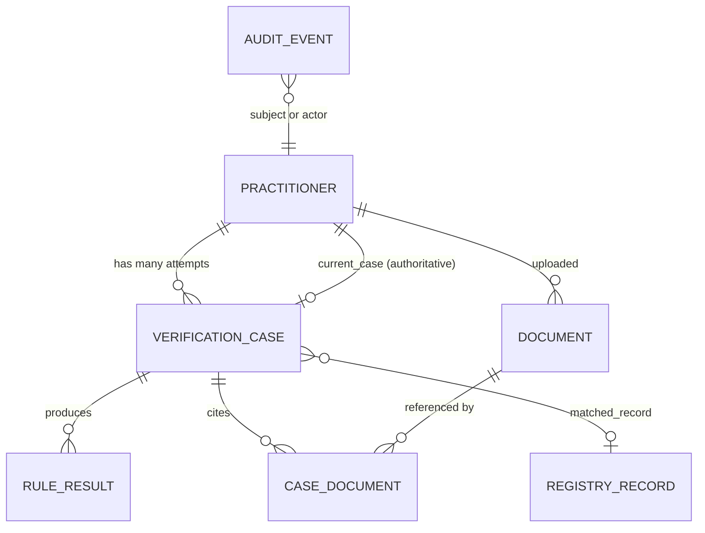
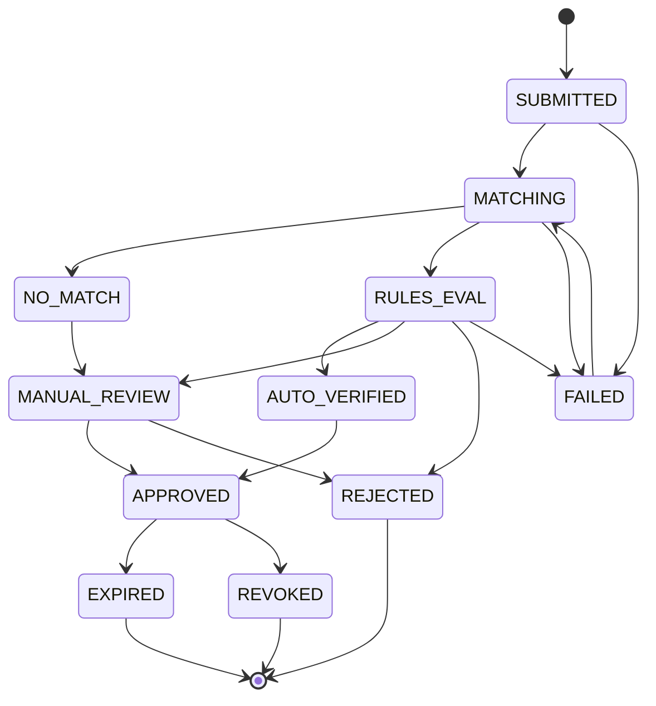
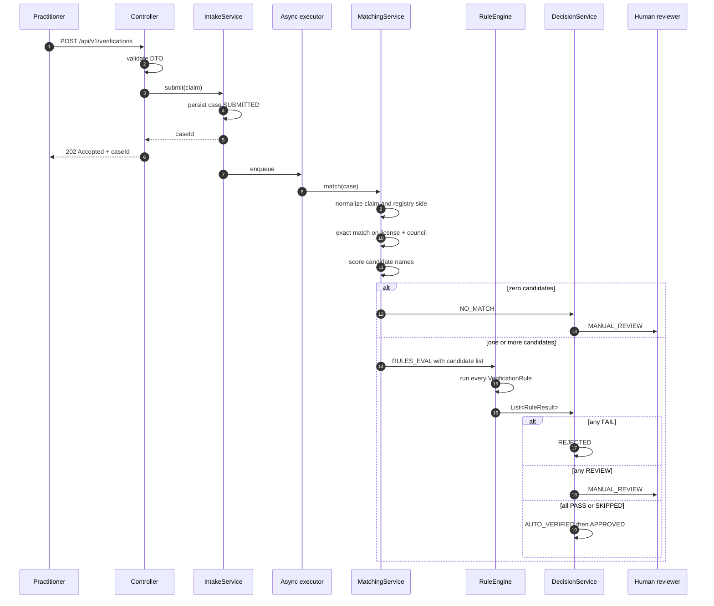

# HerbImmortal Practitioner Verification System

Working brief and design contract. This file is the source of truth for scope,
domain model, and build order. It is loaded into every session.

Status: **design, phase 1 not started.** Open decisions are marked `D1`..`D5` and
must be resolved before the phase that depends on them.

---

## 1. What this system is

A practitioner identity and credential verification service.

We hold a **registry**: a normalized copy of an authoritative external dataset of
licensed practitioners. Practitioners sign up, submit a claimed identity plus
supporting documents, and the system decides whether the claim corresponds to a
real registry record that is currently in good standing.

The output of a successful verification is an **Immortal ID**, a permanent public
identifier that the rest of the HerbImmortal platform uses to ask "is this person
verified right now".

Two things this system is not:

- It is not a document store. Documents are evidence, the registry is truth.
- It is not fully automated. Ambiguity routes to a human reviewer by design.

### 1.1 Facts still needed

These are blanks in the original brief. The first group changes the architecture,
the second group only changes configuration.

**Architecture blocking (needed before phase 2):**

| Fact | Why it changes the design |
|---|---|
| Registry source and transport (CSV dump, Postgres table, third party API, scrape) | Decides whether ingestion is a batch job, a streaming sync, or a live passthrough with cache |
| Full snapshot per batch, or deltas | Decides whether "row absent from this batch" means "delisted" or "no news". See `D2` |
| Exact registry columns and their types | Decides the `registry_records` schema, the unique key, and which rules are even computable |
| Whether license numbers are unique per council or globally | Decides the natural key and the matching predicate |

**Configuration only (can be assumed for now):**

| Fact | Assumed value until told otherwise |
|---|---|
| Registry size | 100k rows, fits in one Postgres table with no partitioning |
| Verification volume at launch | under 500 per day, a single app instance handles this |
| Practitioner type and country | single council, single country, single language, Latin script names |
| Re-verification cadence | daily job, each approved practitioner re-checked every 30 days |

If the real numbers are an order of magnitude larger, say so now. The matching
strategy in phase 5 is the only thing that changes, and only if the registry is
too big to index effectively.

---

## 2. Stack (fixed, no alternatives to be proposed)

| Layer | Choice |
|---|---|
| Language | Java 21 |
| Framework | Spring Boot 3.x, Maven |
| Database | PostgreSQL 16, migrations via Flyway |
| Persistence | Spring Data JPA / Hibernate |
| Auth | Spring Security, JWT |
| Frontend | React + TypeScript, TanStack Query, Tailwind |
| Object storage | S3 compatible, MinIO locally via Docker Compose |
| Containers | Docker, Docker Compose for local dev |
| Tests | JUnit 5, Mockito, Testcontainers |

UI aesthetic: Linear / Vercel / Raycast. Semantic color tokens, no purple
gradients, no em dashes in any copy.

---

## 3. Domain model



### 3.1 Practitioner

The account. Holds login credentials, email, role, and `immortal_id`.

- `immortal_id` is **nullable** until the first approval. Every read path must
  handle a practitioner without one.
- Does **not** hold the claimed license number. A claim belongs to a case,
  because a practitioner can submit a corrected claim after a rejection. The
  original brief put "a claimed identity" on Practitioner, that was wrong.
- Holds `current_case_id`, a pointer to the case that currently defines this
  practitioner's status. See `D1`.

### 3.2 RegistryRecord

One normalized row synced from the external registry. Never edited by hand,
never written by the verification flow.

Required columns beyond the registry's own fields:

| Column | Purpose |
|---|---|
| `normalized_license_no` | matching key, generated on ingest |
| `normalized_name` | fuzzy matching input |
| `council` | second half of the natural key |
| `source_batch` | which import produced this version of the row |
| `first_seen_at` | when we first saw this license |
| `synced_at` | when this row was last written |
| `present_in_latest_batch` | boolean, false instead of deletion |
| `raw` (JSONB) | the untouched source row, for debugging normalization |

Natural key: `(council, normalized_license_no)`, unique index. Upsert on sync.
Nothing is deleted, rows that vanish from a full batch get
`present_in_latest_batch = false`.

### 3.3 VerificationCase

One attempt to verify one practitioner. Immutable once terminal.

Holds: status, `matched_registry_record_id` (nullable), `match_confidence`,
`registry_snapshot` (JSONB, the matched row exactly as it looked at decision
time), the claimed fields as submitted, `submitted_at`, `decided_at`,
`decided_by`, `decision_reason`.

Constraint: **at most one non terminal case per practitioner**, enforced with a
Postgres partial unique index, not application logic:

```sql
CREATE UNIQUE INDEX uq_practitioner_open_case
  ON verification_cases (practitioner_id)
  WHERE status NOT IN ('APPROVED','REJECTED','EXPIRED','REVOKED','NO_MATCH_CLOSED');
```

### 3.4 RuleResult

The outcome of one rule against one case.

The original brief defined this as `(rule_code, passed, detail)`. **A boolean
cannot express this rule catalog**, which has three outcomes (pass, route to
human, hard fail) and needs a fourth for rules that could not run. Corrected
shape:

```
rule_code   String
outcome     RuleOutcome  { PASS, REVIEW, FAIL, SKIPPED }
detail      String        human readable, shown in the review console
evidence    JSONB         the values compared, for audit
evaluated_at Instant
```

### 3.5 Document

An uploaded certificate or ID. Stored in object storage, referenced by ID.

Holds: `storage_key`, `content_type`, `size_bytes`, `sha256`, `uploaded_by`,
`uploaded_at`, `status` (PENDING, CONFIRMED, QUARANTINED), `ocr_result` (JSONB,
nullable). Linked to cases through a `case_documents` join table, because the
same ID scan can support multiple cases over time.

Every read of a document body produces an audit event.

### 3.6 AuditEvent

Append only, never updated, never deleted.

The brief's shape (`actor, from_status, to_status, reason, timestamp`) only
describes status changes. Immortal ID issuance, document reads, logins, and
registry syncs are also auditable and have no status transition. Corrected
shape:

```
id           UUID
event_type   AuditEventType   STATUS_CHANGE | IMMORTAL_ID_ISSUED | DOCUMENT_READ
                              | DOCUMENT_UPLOADED | MANUAL_DECISION
                              | REGISTRY_SYNC | AUTH_LOGIN | ...
subject_type String           "verification_case" | "practitioner" | "document"
subject_id   UUID             no FK, the subject table varies
actor_type   ActorType        USER | SYSTEM | SCHEDULED_JOB
actor_id     UUID             nullable when actor_type != USER
from_status  String           nullable
to_status    String           nullable
reason       String           mandatory for MANUAL_DECISION
metadata     JSONB
created_at   Instant
```

No foreign key on `subject_id` is deliberate. A polymorphic FK is not
expressible in Postgres without a join table per subject type, and the audit log
must be able to outlive shape changes in the tables it describes.

---

## 4. Status machine

Implemented as `enum CaseStatus` plus an explicit
`Map<CaseStatus, Set<CaseStatus>>` of allowed transitions. Any transition not in
the map throws `IllegalStatusTransitionException`, which the
`@RestControllerAdvice` maps to HTTP 409.



### 4.1 Corrections to the original machine

Four defects in the brief's transition list, and how they are resolved.

**a. `EXPIRED -> MATCHING` contradicts "a case is one attempt."**
A case that goes back to MATCHING is no longer one attempt, it is a mutable
record whose `decided_at` and `registry_snapshot` get overwritten, which breaks
non negotiable 2. Resolved: re-verification **opens a new case**. EXPIRED is
terminal at the case level. `Practitioner.current_case_id` moves to the new case.
See `D1`, this is the one decision I want confirmed before phase 4.

**b. REVOKED had no exit, but the Immortal ID section requires re-approval.**
Same resolution. REVOKED is terminal for the case, the practitioner can hold a
new case later, and the Immortal ID lives on Practitioner so it survives
untouched.

**c. `LICENSE_FOUND` could hard fail into REJECTED, but NO_MATCH could only go
to MANUAL_REVIEW.** Two rules for the same situation. Resolved: "found or not
found" is decided by the matching stage, not by a rule. Zero candidates means
NO_MATCH means MANUAL_REVIEW, always. A human closes it. See rule catalog.

**d. No terminal state for a crashed pipeline.** OCR times out, the registry
table is locked, the fuzzy matcher throws. Without a FAILED state those cases sit
in MATCHING forever and nothing distinguishes "in progress" from "dead."
Resolved: FAILED, with a retry edge back to MATCHING and an ops alert.

### 4.2 Practitioner status is derived, never stored as a flag

The public endpoint and the platform lookup read
`practitioner -> current_case -> status`. There is no `is_verified` boolean on
Practitioner. Non negotiable 3 requires this: a revoked practitioner must stop
reading as verified everywhere the moment the case flips, and a denormalized flag
is exactly how that goes wrong.

---

## 5. Pipeline



### 5.1 Normalization

Applied identically to the claim and to the registry row, in one shared class, at
ingest time for the registry and at intake time for the claim. Uppercase, strip
titles and honorifics, collapse whitespace, strip punctuation, canonicalize the
license number format. Normalized values are **stored**, not computed per query,
so they can be indexed.

### 5.2 Matching

Returns `List<MatchCandidate>`, never `Optional`. Duplicates and ambiguity are
real and the review console needs to show all of them side by side.

`MatchCandidate` carries the registry record, the name similarity score, and
which predicate matched (exact license, fuzzy license fallback).

### 5.3 Decision

Deterministic and order independent:

1. any `FAIL` outcome, and no `REVIEW` that outranks it, gives REJECTED
2. otherwise any `REVIEW` outcome gives MANUAL_REVIEW
3. otherwise all `PASS` or `SKIPPED` gives AUTO_VERIFIED, then immediately
   APPROVED in the same transaction
4. a `SKIPPED` result for a rule marked `required = true` is promoted to `REVIEW`

The engine never inspects rule codes. It only aggregates outcomes.

---

## 6. Rule catalog v1

`interface VerificationRule { RuleResult evaluate(VerificationContext ctx); }`,
one `@Component` per rule, injected into the engine as `List<VerificationRule>`.

| Code | Check | PASS | REVIEW | FAIL | Required in v1 |
|---|---|---|---|---|---|
| `LICENSE_ACTIVE` | registry status is active | active | - | anything else | yes |
| `NOT_EXPIRED` | `valid_until` is in the future | future date | within grace window, see `D3` | past date | yes |
| `NOT_SANCTIONED` | status is not suspended or revoked | clean | - | suspended or revoked | yes |
| `NAME_MATCH` | similarity of claimed vs registry name | >= 0.90 | 0.75 to 0.90 | < 0.75 | yes |
| `SINGLE_CANDIDATE` | exactly one candidate matched | 1 candidate | 2 or more | - | yes |
| `DOC_CONSISTENT` | OCR license number equals the claim | equal | mismatch, or no OCR available | - | **no** until phase 9 |

`LICENSE_FOUND` is removed from the catalog. It is a matching stage outcome, not
a rule. Reaching RULES_EVAL already proves a record was found, so the rule could
never fail there, and it duplicated the NO_MATCH path. The fact is still recorded
in the audit trail by the matching stage.

`DOC_CONSISTENT` is `required = false` until phase 9 ships OCR. Before then it
returns SKIPPED, which the engine ignores. This is why the SKIPPED outcome
exists: the rule catalog is written once and rules light up as their inputs
arrive, without editing the engine or the decision logic.

### 6.1 Why Strategy here

The alternative is a `DecisionService` with a chain of `if` statements. It works
until the day someone asks for a new check, and then the diff touches the one
class that every verification path runs through, which is also the class with the
most test coverage and the most risk.

With the Strategy interface, adding a rule is: write one `@Component`, write one
unit test for it in isolation, done. The engine is closed for modification.
Spring's collection injection is what makes it cheap, see 8.3.

Revisit if rules ever need ordering or short circuiting for cost reasons. At
seven in memory rules, running all of them always is correct and simpler, and it
means the review console can show a reviewer every check, including the ones that
passed.

---

## 7. API surface v1

```
POST   /api/v1/auth/register
POST   /api/v1/auth/login
POST   /api/v1/auth/refresh                 added, JWT needs a rotation story
GET    /api/v1/me

POST   /api/v1/verifications                202 + caseId, Idempotency-Key header
GET    /api/v1/verifications/{id}           status, rule results, next action
GET    /api/v1/verifications                my cases, paginated

POST   /api/v1/documents/presign
POST   /api/v1/documents/confirm

GET    /api/v1/admin/review                 MANUAL_REVIEW queue, paginated
GET    /api/v1/admin/review/{id}            claim vs registry vs document
POST   /api/v1/admin/review/{id}/decide     approve or reject, reason mandatory
POST   /api/v1/admin/practitioners/{immortalId}/revoke   added, reason mandatory
GET    /api/v1/admin/cases                  added, all statuses, filterable

GET    /api/v1/public/verify?immortalId=     cached, rate limited, no auth
GET    /api/v1/internal/practitioners/{immortalId}   service auth, see D4
```

Four additions and why:

- **`/auth/refresh`**: the brief specified JWT but no expiry or rotation policy.
  Short lived access token plus refresh token, otherwise a revoked practitioner
  keeps a valid token until it expires, which contradicts non negotiable 3.
- **`/admin/practitioners/{id}/revoke`**: `APPROVED -> REVOKED` was in the state
  machine with nothing in the API able to trigger it.
- **`/admin/cases`**: reviewers need to look up a case that is not currently in
  the review queue, for example to answer a support ticket about a rejection.
- **`/internal/...` prefix**: moved off `/api/v1/practitioners/` so the auth
  mechanism is visible in the path and easy to gate at the gateway.

### 7.1 Idempotency

`POST /api/v1/verifications` takes an `Idempotency-Key` header. A double click
must not create two cases. The partial unique index in 3.3 is the backstop, the
header gives a clean 200 with the existing caseId instead of a 409.

### 7.2 Public endpoint response

Never a bare boolean. Minimum viable body:

```json
{
  "immortalId": "HI-K3M7Q-8XT2A",
  "displayName": "A. Sharma",
  "status": "VERIFIED",
  "verifiedAsOf": "2026-07-14",
  "registrySourceBatch": "council-2026-07-14",
  "council": "..."
}
```

Non negotiable 4: the UI renders "Verified as of 14 July 2026, source
council-2026-07-14", not a green tick.

### 7.3 Roles

`PRACTITIONER`, `REVIEWER`, `ADMIN`, enforced with `@PreAuthorize`. Ownership is
a separate check from role: a PRACTITIONER hitting
`GET /api/v1/verifications/{id}` must be denied a case that is not theirs, and
the denial must be 404 rather than 403 so the endpoint does not confirm that
someone else's case ID exists.

---

## 8. Immortal ID

### 8.1 Semantics (unchanged from the brief)

1. Issued by this system, never submitted by the practitioner.
2. Issued exactly once, on the **first** transition into APPROVED, in the same
   transaction as the status change.
3. Permanent and immutable. Re-approval after EXPIRED or REVOKED returns the same
   ID. Status changes, identity does not.
4. The primary lookup key for everything after the first verification.
5. **Not** the matching key. First match keys on normalized license number plus
   council, because the registry is external data and cannot contain an
   identifier we invented. These two lookups are never interchangeable.

### 8.2 Format, corrected

```
HI-XXXXX-XXXXX
   \_________/
    9 random Crockford base32 chars + 1 check char
```

The brief asked for `HI-XXXXXXX`. With 6 random characters plus a check
character that is 32^6, about 1.07 billion IDs. That is enumerable: a scraper at
1000 requests per second walks a meaningful fraction of it, so the rate limiter
becomes the only thing protecting the directory rather than defense in depth.

9 random characters is 45 bits, about 3.5e13. Enumeration is off the table and
rate limiting goes back to being a second line of defense. Grouped 5 and 5 it
reads aloud in two chunks, like an airline record locator.

Crockford base32 is right for the body: no I, L, O, or U, so the classic
transcription errors cannot occur, and decoding is case insensitive.

**Check character:** Crockford's own specification uses a modulo 37 check symbol
whose alphabet includes `* ~ $ = U`. Those look like corruption on a printed
certificate. Use a Luhn mod 32 check character over the standard Crockford
alphabet instead. It catches every single character error and almost every
adjacent transposition, and it keeps the ID in one clean character set. The React
client validates it before the request is sent.

### 8.3 Issuance and collisions, the part that will bite

Unique constraint on `practitioners.immortal_id` at the database level.
Generation retried on collision. Never trust the generator alone.

The trap: **in Postgres, a unique constraint violation aborts the entire
transaction.** A retry loop inside the same `@Transactional` method does not
work. The second `INSERT` fails with "current transaction is aborted", and
Hibernate's persistence context is left in an unrecoverable state after a
`ConstraintViolationException`, so you must not keep using that `EntityManager`
either.

Correct shape: the retry lives **outside** the transaction boundary. The approval
method is called again in a fresh transaction on
`DataIntegrityViolationException`, up to 3 attempts. At 45 bits of entropy and
100k practitioners, the lifetime probability of ever needing attempt 2 is around
1e-4, so the retry path is an assertion, not a hot path. It still gets a test.

Issuance is logged as its own `IMMORTAL_ID_ISSUED` audit event, separate from the
`STATUS_CHANGE` event for the same transition.

---

## 9. Package structure

```mermaid
flowchart TD
    C[controller<br/>HTTP only] --> S[service<br/>all business logic]
    C --> DTO[dto<br/>request/response records]
    J[job<br/>scheduled re-verification] --> S
    S --> RU[rules<br/>one class per rule]
    S --> RE[repository<br/>Spring Data JPA]
    RE --> D[domain<br/>entities, enums, state machine]
    RU --> D
    S --> D
    SEC[security<br/>JWT filter, UserDetails] --> C
    CFG[config<br/>Security, Async, Scheduler, Cache] -.wires.-> SEC
    EX[exception<br/>@RestControllerAdvice] -.handles.-> C
```

```
com.herbimmortal.verification
  ├── controller      validate, map DTOs, return status codes, nothing else
  ├── dto             request/response records
  ├── service         IntakeService, MatchingService, RuleEngine,
  │                   DecisionService, DocumentService, RegistryIngestService
  ├── rules           one @Component per rule
  ├── domain          @Entity classes, enums, StatusMachine
  ├── repository      Spring Data JPA interfaces
  ├── security        JwtAuthenticationFilter, JwtService, UserPrincipal
  ├── job             ReVerificationJob, RegistrySyncJob
  ├── config          SecurityConfig, AsyncConfig, SchedulerConfig, CacheConfig
  └── exception       GlobalExceptionHandler
```

Two packages added to the brief's structure. `security` and `job` hold classes,
not configuration, and putting a servlet filter or a `@Scheduled` bean inside
`config` mixes wiring with behaviour.

All verification logic lives in `service` so that the HTTP path, the scheduled
re-verification job, and any bulk import run identical code. No business logic in
controllers, ever.

---

## 10. Non negotiables

1. Nothing is hard deleted. Append to the audit log instead.
2. Every decision persists a `registry_snapshot` JSONB of the matched row as it
   was at that moment. If the registry changes later, we can still prove what we
   saw.
3. Verified status is read live from the current case. No cached boolean flag
   anywhere, in this service or downstream.
4. The UI never shows a bare green tick. It shows "verified as of DATE" plus the
   source batch.
5. Documents are encrypted at rest, access is role restricted, every read is
   logged.
6. The public endpoint is cached and rate limited so the registry cannot be
   scraped through our own API.
7. Verification is asynchronous from intake onward. No HTTP thread ever blocks on
   OCR or fuzzy matching. Phase 5 runs synchronously as a deliberate temporary
   exception, removed in phase 9.
8. Ambiguity routes to a human. Full automation is not a v1 goal.

Known tension with 1: a practitioner's right to erasure conflicts with append
only audit. Out of scope for v1, but design the audit metadata so PII sits in
columns that could later be crypto shredded rather than inline in free text.

---

## 11. Build order

Do not start a phase until the previous one is confirmed running on my machine.

| Phase | Deliverable | Notes |
|---|---|---|
| 1 | Scaffold, Docker Compose with Postgres, Flyway, health endpoint | |
| 2 | Registry ingestion into `registry_records` with indexes | blocked on `D2` and the registry facts in 1.1 |
| 3 | CRUD: signup, submit case, get case, no verification logic | cases sit in SUBMITTED, no transitions exist yet |
| 4 | Status machine plus audit log | blocked on `D1` |
| 5 | Exact license matching, hardcoded rules, synchronous | first real verification, sync is temporary |
| 6 | Manual review console (React) plus admin endpoints | see the security note below |
| 7 | Fuzzy name scoring, thresholds, full catalog behind Strategy | |
| 8 | Spring Security, JWT, roles, ownership checks | |
| 9 | Async processing, presigned uploads, OCR | non negotiable 7 satisfied here |
| 10 | Scheduled re-verification, notifications, public API with cache and limits | |
| 11 | Unit tests on engine and matcher, Testcontainers lifecycle tests | tests are written per phase too, this phase is for the full lifecycle suite |

Phases 1 to 6 are the real MVP. A verification system with a good review console
and dumb matching is useful. One with clever matching and no review console is
not.

**Security note on the ordering.** Phases 6 and 7 expose admin endpoints two
phases before authentication exists. That is an acceptable local dev tradeoff and
the ordering stays, but the admin controllers get gated behind a Spring profile
(`@Profile("dev")`) until phase 8, so a production build physically cannot serve
an unauthenticated review queue.

---

## 12. Open decisions

| ID | Decision | Options | My recommendation | Blocks |
|---|---|---|---|---|
| `D1` | Re-verification: new case or reuse the existing one | (a) new case per run, EXPIRED terminal (b) reuse, `EXPIRED -> MATCHING` as originally written | **(a)**. Preserves "one case is one attempt", keeps `registry_snapshot` and `decided_at` immutable, and gives REVOKED a way back to approved. Costs one extra pointer, `current_case_id`. | phase 4 |
| `D2` | Registry sync semantics | (a) full snapshot per batch (b) deltas | Depends on the source. If full, absence means delisted and `present_in_latest_batch=false` is meaningful. If deltas, absence means nothing and that flag must not exist. | phase 2 |
| `D3` | Grace window on `NOT_EXPIRED` | (a) hard fail the day after `valid_until` (b) N day grace routing to review | **(b) with 30 days.** Renewals lag registry updates and hard failing on day one generates support load and false rejections of genuine practitioners. | phase 7 |
| `D4` | Auth for the internal platform lookup | (a) shared static API key (b) OAuth2 client credentials (c) a JWT with a SERVICE role | **(a) for v1**, header based, rotatable, plus IP allowlist. (b) is correct long term but is a whole authorization server to run for one consumer. Revisit at the second consumer. | phase 10 |
| `D5` | Rate limit strategy on the public endpoint | (a) Bucket4j in memory (b) Bucket4j backed by Redis | **(a) for v1** at a single instance. Move to (b) the moment there are two app instances, because in memory limits multiply by instance count. | phase 10 |

---

## 13. Out of scope for v1

Multi country registries, practitioner profile pages, appeals workflow, bulk
employer verification, third party webhooks, mobile app.

Leave room for, do not build:

- **Multi country**: `council` is already part of the natural key, so a second
  registry is a new set of rows, not a schema change. Do not hardcode a single
  council anywhere outside configuration.
- **Appeals**: a rejected practitioner submitting a new case already covers the
  90 percent case, since REJECTED is terminal per case and not per person.
- **Webhooks**: the audit log is the event source a future outbox would read
  from. Keep `AuditEvent` complete enough to replay.

---

## 14. How to work with me

I am a full stack developer (Next.js, TypeScript, FastAPI, Python, Postgres) and
a **beginner in Java and Spring Boot**.

- One phase at a time. Design first, get agreement, then code, then exact steps
  to run and verify.
- No code until the design for the current phase is agreed.
- Every Spring specific thing (annotation, bean, filter chain, repository
  derivation) gets a one line "what this actually does" plus the FastAPI or
  Express equivalent.
- Never hand me a large block of Java without walking through what each
  annotation does.
- Justify meaningful choices as: why this, why not the obvious alternative, when
  to revisit.
- Mermaid diagrams instead of prose descriptions of structure.
- End of each phase: a checklist of what should now work, plus 3 to 5 questions
  to check I actually understood it.
- When I paste code back, review it directly. What is wrong first, what is good
  second.
- No em dashes in anything you write.
