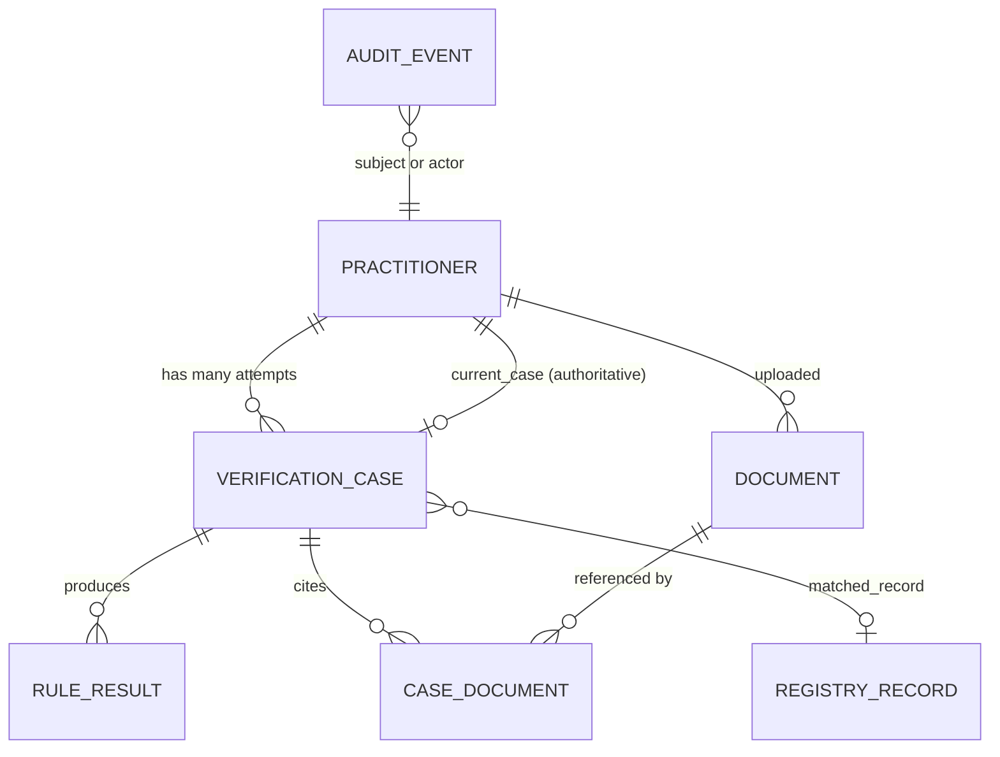
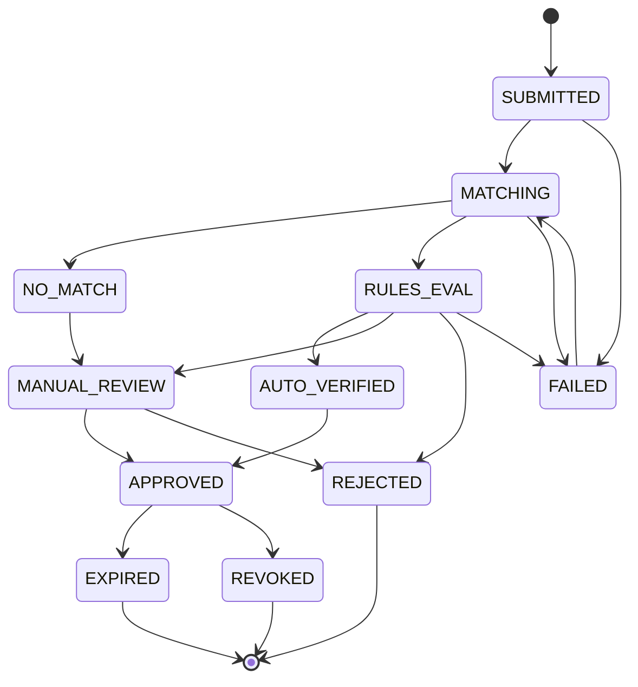
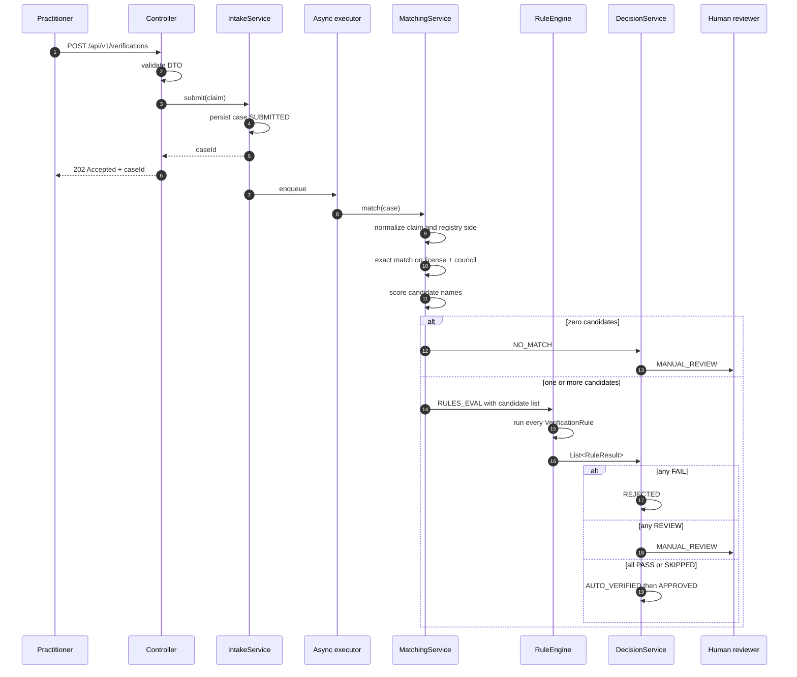

# HerbImmortal Practitioner Verification System

Working brief and design contract. This file is the source of truth for scope,
domain model, and build order. It is loaded into every session.

Status: **design, phase 1 not started.** Open decisions are marked `D1`..`D5` and
must be resolved before the phase that depends on them.

---

## 1. What this system is

A practitioner identity and credential verification service.

We hold a **registry**: a normalized copy of an authoritative external dataset of
licensed practitioners. Practitioners sign up, submit a claimed identity plus
supporting documents, and the system decides whether the claim corresponds to a
real registry record that is currently in good standing.

The output of a successful verification is an **Immortal ID**, a permanent public
identifier that the rest of the HerbImmortal platform uses to ask "is this person
verified right now".

Two things this system is not:

- It is not a document store. Documents are evidence, the registry is truth.
- It is not fully automated. Ambiguity routes to a human reviewer by design.

### 1.1 Facts still needed

These are blanks in the original brief. The first group changes the architecture,
the second group only changes configuration.

**Architecture blocking (needed before phase 2):**

| Fact | Why it changes the design |
|---|---|
| Registry source and transport (CSV dump, Postgres table, third party API, scrape) | Decides whether ingestion is a batch job, a streaming sync, or a live passthrough with cache |
| Full snapshot per batch, or deltas | Decides whether "row absent from this batch" means "delisted" or "no news". See `D2` |
| Exact registry columns and their types | Decides the `registry_records` schema, the unique key, and which rules are even computable |
| Whether license numbers are unique per council or globally | Decides the natural key and the matching predicate |

**Configuration only (can be assumed for now):**

| Fact | Assumed value until told otherwise |
|---|---|
| Registry size | 100k rows, fits in one Postgres table with no partitioning |
| Verification volume at launch | under 500 per day, a single app instance handles this |
| Practitioner type and country | single council, single country, single language, Latin script names |
| Re-verification cadence | daily job, each approved practitioner re-checked every 30 days |

If the real numbers are an order of magnitude larger, say so now. The matching
strategy in phase 5 is the only thing that changes, and only if the registry is
too big to index effectively.

---

## 2. Stack (fixed, no alternatives to be proposed)

| Layer | Choice |
|---|---|
| Language | Java 21 |
| Framework | Spring Boot 3.x, Maven |
| Database | PostgreSQL 16, migrations via Flyway |
| Persistence | Spring Data JPA / Hibernate |
| Auth | Spring Security, JWT |
| Frontend | React + TypeScript, TanStack Query, Tailwind |
| Object storage | S3 compatible, MinIO locally via Docker Compose |
| Containers | Docker, Docker Compose for local dev |
| Tests | JUnit 5, Mockito, Testcontainers |

UI aesthetic: Linear / Vercel / Raycast. Semantic color tokens, no purple
gradients, no em dashes in any copy.

---

## 3. Domain model



### 3.0 User

The **login**, added in phase 8 (V10). Email (stored lowercased, unique),
BCrypt password hash, role, status, lockout counter.

Deliberately **not** the same table as Practitioner, and neither owns the other:

- a user may hold no registration at all (a reviewer, an admin, or someone who
  signed up and has not claimed yet)
- a registration exists whether or not anyone ever logs in for it, because 3.1
  keys it on `(council, licence)` and the registry is external

So the link is a nullable `practitioners.user_id`. Collapsing the two would mean
either inventing a login for every row of a council register, or losing the
registration identity matching depends on.

`verification_cases.submitted_by_user_id` is denormalized from that link on
purpose: ownership is checked on every case read, and going through
practitioners would put a join on the hottest authorization path and make
ownership mutable. Who submitted a claim is a fact about the moment it was
submitted.

### 3.1 Practitioner

The registration. Holds `immortal_id`, the country and medical system it was
built from, and a nullable `user_id` pointing at the account that claimed it.

- `immortal_id` is **nullable** until the first approval. Every read path must
  handle a practitioner without one.
- `user_id` is **nullable** and stays that way. Rows created before accounts
  existed have no honest owner, and guessing one would attach a stranger's
  verified identity to somebody's login. First claim wins; a second account
  claiming the same registration gets a 409, because two accounts on one licence
  is either a mistake or an impersonation and a person has to look at it.
- Does **not** hold the claimed license number. A claim belongs to a case,
  because a practitioner can submit a corrected claim after a rejection. The
  original brief put "a claimed identity" on Practitioner, that was wrong.
- Holds `current_case_id`, a pointer to the case that currently defines this
  practitioner's status. See `D1`.
- Holds `country_code`, `medical_system_code` and `immortal_id_issued_at`: the
  three inputs the Immortal ID was built from, stored next to the output they
  produced. **Not derived at read time.** If a practitioner later corrects their
  medical system, `HI-26INA-...` still has to decode back to Ayurveda, because
  that is what was true when it was issued and the ID does not change. Deriving
  from the council or the latest case would make the ID and its own meaning
  disagree. See 8.2.

### 3.2 RegistryRecord

One normalized row synced from the external registry. Never edited by hand,
never written by the verification flow.

Required columns beyond the registry's own fields:

| Column | Purpose |
|---|---|
| `normalized_license_no` | matching key, generated on ingest |
| `normalized_name` | fuzzy matching input |
| `council` | second half of the natural key |
| `source_batch` | which import produced this version of the row |
| `first_seen_at` | when we first saw this license |
| `synced_at` | when this row was last written |
| `present_in_latest_batch` | boolean, false instead of deletion |
| `raw` (JSONB) | the untouched source row, for debugging normalization |

Natural key: `(council, normalized_license_no)`, unique index. Upsert on sync.
Nothing is deleted, rows that vanish from a full batch get
`present_in_latest_batch = false`.

### 3.3 VerificationCase

One attempt to verify one practitioner. Immutable once terminal.

Holds: status, `matched_registry_record_id` (nullable), `match_confidence`,
`registry_snapshot` (JSONB, the matched row exactly as it looked at decision
time), the claimed fields as submitted, `submitted_at`, `decided_at`,
`decided_by`, `decision_reason`.

Constraint: **at most one non terminal case per practitioner**, enforced with a
Postgres partial unique index, not application logic:

```sql
CREATE UNIQUE INDEX uq_practitioner_open_case
  ON verification_cases (practitioner_id)
  WHERE status NOT IN ('APPROVED','REJECTED','EXPIRED','REVOKED','NO_MATCH_CLOSED');
```

### 3.4 RuleResult

The outcome of one rule against one case.

The original brief defined this as `(rule_code, passed, detail)`. **A boolean
cannot express this rule catalog**, which has three outcomes (pass, route to
human, hard fail) and needs a fourth for rules that could not run. Corrected
shape:

```
rule_code   String
outcome     RuleOutcome  { PASS, REVIEW, FAIL, SKIPPED }
detail      String        human readable, shown in the review console
evidence    JSONB         the values compared, for audit
evaluated_at Instant
```

### 3.5 Document

An uploaded certificate or ID. Stored in object storage, referenced by ID.

Holds: `storage_key`, `content_type`, `size_bytes`, `sha256`, `uploaded_by`,
`uploaded_at`, `status` (PENDING, CONFIRMED, QUARANTINED), `ocr_result` (JSONB,
nullable). Linked to cases through a `case_documents` join table, because the
same ID scan can support multiple cases over time.

Every read of a document body produces an audit event.

### 3.6 AuditEvent

Append only, never updated, never deleted.

The brief's shape (`actor, from_status, to_status, reason, timestamp`) only
describes status changes. Immortal ID issuance, document reads, logins, and
registry syncs are also auditable and have no status transition. Corrected
shape:

```
id           UUID
event_type   AuditEventType   STATUS_CHANGE | IMMORTAL_ID_ISSUED | DOCUMENT_READ
                              | DOCUMENT_UPLOADED | MANUAL_DECISION
                              | REGISTRY_SYNC | AUTH_LOGIN | ...
subject_type String           "verification_case" | "practitioner" | "document"
subject_id   UUID             no FK, the subject table varies
actor_type   ActorType        USER | SYSTEM | SCHEDULED_JOB
actor_id     UUID             nullable when actor_type != USER
from_status  String           nullable
to_status    String           nullable
reason       String           mandatory for MANUAL_DECISION
metadata     JSONB
created_at   Instant
```

No foreign key on `subject_id` is deliberate. A polymorphic FK is not
expressible in Postgres without a join table per subject type, and the audit log
must be able to outlive shape changes in the tables it describes.

---

## 4. Status machine

Implemented as `enum CaseStatus` plus an explicit
`Map<CaseStatus, Set<CaseStatus>>` of allowed transitions. Any transition not in
the map throws `IllegalStatusTransitionException`, which the
`@RestControllerAdvice` maps to HTTP 409.



### 4.1 Corrections to the original machine

Four defects in the brief's transition list, and how they are resolved.

**a. `EXPIRED -> MATCHING` contradicts "a case is one attempt."**
A case that goes back to MATCHING is no longer one attempt, it is a mutable
record whose `decided_at` and `registry_snapshot` get overwritten, which breaks
non negotiable 2. Resolved: re-verification **opens a new case**. EXPIRED is
terminal at the case level. `Practitioner.current_case_id` moves to the new case.
See `D1`, this is the one decision I want confirmed before phase 4.

**b. REVOKED had no exit, but the Immortal ID section requires re-approval.**
Same resolution. REVOKED is terminal for the case, the practitioner can hold a
new case later, and the Immortal ID lives on Practitioner so it survives
untouched.

**c. `LICENSE_FOUND` could hard fail into REJECTED, but NO_MATCH could only go
to MANUAL_REVIEW.** Two rules for the same situation. Resolved: "found or not
found" is decided by the matching stage, not by a rule. Zero candidates means
NO_MATCH means MANUAL_REVIEW, always. A human closes it. See rule catalog.

**d. No terminal state for a crashed pipeline.** OCR times out, the registry
table is locked, the fuzzy matcher throws. Without a FAILED state those cases sit
in MATCHING forever and nothing distinguishes "in progress" from "dead."
Resolved: FAILED, with a retry edge back to MATCHING and an ops alert.

### 4.2 Practitioner status is derived, never stored as a flag

The public endpoint and the platform lookup read
`practitioner -> current_case -> status`. There is no `is_verified` boolean on
Practitioner. Non negotiable 3 requires this: a revoked practitioner must stop
reading as verified everywhere the moment the case flips, and a denormalized flag
is exactly how that goes wrong.

---

## 5. Pipeline



### 5.1 Normalization

Applied identically to the claim and to the registry row, in one shared class, at
ingest time for the registry and at intake time for the claim. Uppercase, strip
titles and honorifics, collapse whitespace, strip punctuation, canonicalize the
license number format. Normalized values are **stored**, not computed per query,
so they can be indexed.

### 5.2 Matching

Returns `List<MatchCandidate>`, never `Optional`. Duplicates and ambiguity are
real and the review console needs to show all of them side by side.

`MatchCandidate` carries the registry record, the name similarity score, and
which predicate matched (exact license, fuzzy license fallback).

### 5.3 Decision

Deterministic and order independent:

1. any `FAIL` outcome, and no `REVIEW` that outranks it, gives REJECTED
2. otherwise any `REVIEW` outcome gives MANUAL_REVIEW
3. otherwise all `PASS` or `SKIPPED` gives AUTO_VERIFIED, then immediately
   APPROVED in the same transaction
4. a `SKIPPED` result for a rule marked `required = true` is promoted to `REVIEW`

The engine never inspects rule codes. It only aggregates outcomes.

---

## 6. Rule catalog v1

`interface VerificationRule { RuleResult evaluate(VerificationContext ctx); }`,
one `@Component` per rule, injected into the engine as `List<VerificationRule>`.

| Code | Check | PASS | REVIEW | FAIL | Required in v1 |
|---|---|---|---|---|---|
| `LICENSE_ACTIVE` | registry status is active | active | `UNKNOWN` | suspended, revoked, expired, inactive | yes |
| `NOT_EXPIRED` | `valid_until` is in the future | future date | within grace window, see `D3` | past date | yes |
| `NOT_SANCTIONED` | status is not suspended or revoked | clean | - | suspended or revoked | yes |
| `NAME_MATCH` | similarity of claimed vs registry name | >= 0.90 | 0.75 to 0.90 | < 0.75 | yes |
| `SINGLE_CANDIDATE` | exactly one candidate matched | 1 candidate | 2 or more | - | yes |
| `DOC_CONSISTENT` | OCR license number equals the claim | equal | mismatch, or no OCR available | - | **no** until phase 9 |

`LICENSE_ACTIVE` sends `UNKNOWN` to REVIEW rather than FAIL. This is the one
place where "we could not read it" and "it is not active" must not collapse into
the same answer. Real registers exist that publish no standing status at all:
the NCISM provisional national registers print a registration number, a date and
a board name, and nothing about suspension. Failing `UNKNOWN` would auto reject
every practitioner in such a register, silently and in bulk, on a fact the
document never asserted. Passing it would assert good standing we cannot see.
REVIEW is the only honest third answer, and non negotiable 8 already says
ambiguity goes to a person.

The absence is recorded deliberately, not inferred. The column mapping screen
requires the admin to tick "this register does not publish a standing status"
before it will accept a mapping with no status column, because a forgotten
mapping and a register that genuinely has none look identical in the column map
and need opposite outcomes.

`LICENSE_FOUND` is removed from the catalog. It is a matching stage outcome, not
a rule. Reaching RULES_EVAL already proves a record was found, so the rule could
never fail there, and it duplicated the NO_MATCH path. The fact is still recorded
in the audit trail by the matching stage.

`DOC_CONSISTENT` is `required = false` until phase 9 ships OCR. Before then it
returns SKIPPED, which the engine ignores. This is why the SKIPPED outcome
exists: the rule catalog is written once and rules light up as their inputs
arrive, without editing the engine or the decision logic.

### 6.1 Why Strategy here

The alternative is a `DecisionService` with a chain of `if` statements. It works
until the day someone asks for a new check, and then the diff touches the one
class that every verification path runs through, which is also the class with the
most test coverage and the most risk.

With the Strategy interface, adding a rule is: write one `@Component`, write one
unit test for it in isolation, done. The engine is closed for modification.
Spring's collection injection is what makes it cheap, see 8.3.

Revisit if rules ever need ordering or short circuiting for cost reasons. At
seven in memory rules, running all of them always is correct and simpler, and it
means the review console can show a reviewer every check, including the ones that
passed.

---

## 7. API surface v1

```
POST   /api/v1/auth/register
POST   /api/v1/auth/login
POST   /api/v1/auth/refresh                 added, JWT needs a rotation story
GET    /api/v1/me

POST   /api/v1/verifications                202 + caseId, Idempotency-Key header
GET    /api/v1/verifications/{id}           status, rule results, next action
GET    /api/v1/verifications                my cases, paginated

POST   /api/v1/documents/presign
POST   /api/v1/documents/confirm

GET    /api/v1/admin/review                 MANUAL_REVIEW queue, paginated
GET    /api/v1/admin/review/{id}            claim vs registry vs document
POST   /api/v1/admin/review/{id}/decide     approve or reject, reason mandatory
POST   /api/v1/admin/practitioners/{immortalId}/revoke   added, reason mandatory
GET    /api/v1/admin/cases                  added, all statuses, filterable

GET    /api/v1/public/verify?immortalId=     cached, rate limited, no auth
GET    /api/v1/internal/practitioners/{immortalId}   service auth, see D4
```

Four additions and why:

- **`/auth/refresh`**: the brief specified JWT but no expiry or rotation policy.
  Short lived access token plus refresh token, otherwise a revoked practitioner
  keeps a valid token until it expires, which contradicts non negotiable 3.
- **`/admin/practitioners/{id}/revoke`**: `APPROVED -> REVOKED` was in the state
  machine with nothing in the API able to trigger it.
- **`/admin/cases`**: reviewers need to look up a case that is not currently in
  the review queue, for example to answer a support ticket about a rejection.
- **`/internal/...` prefix**: moved off `/api/v1/practitioners/` so the auth
  mechanism is visible in the path and easy to gate at the gateway.

### 7.1 Idempotency

`POST /api/v1/verifications` takes an `Idempotency-Key` header. A double click
must not create two cases. The partial unique index in 3.3 is the backstop, the
header gives a clean 200 with the existing caseId instead of a 409.

### 7.2 Public endpoint response

Never a bare boolean. Minimum viable body:

```json
{
  "immortalId": "HI-26INA-K3M7Q",
  "displayName": "A. Sharma",
  "status": "VERIFIED",
  "verifiedAsOf": "2026-07-14",
  "registrySourceBatch": "council-2026-07-14",
  "council": "...",
  "country": "India",
  "countryCode": "IN",
  "medicalSystem": "Ayurveda"
}
```

Non negotiable 4: the UI renders "Verified as of 14 July 2026, source
council-2026-07-14", not a green tick.

`country` and `medicalSystem` are read from the practitioner record, never
decoded from the ID in the query string. Decoding would make the caller's own
input the source of the answer, and a legacy ID carries neither segment.

Every field is present on a `NOT_VERIFIED` answer too, as an empty string. An
unknown ID and an unverified one have to be byte for byte indistinguishable: a
field appearing only on the verified branch leaks existence through the response
*shape*, which is the version of that bug that survives a review of the values.

### 7.3 Roles

`PRACTITIONER`, `REVIEWER`, `ADMIN`, enforced with `@PreAuthorize`. Ownership is
a separate check from role: a PRACTITIONER hitting
`GET /api/v1/verifications/{id}` must be denied a case that is not theirs, and
the denial must be 404 rather than 403 so the endpoint does not confirm that
someone else's case ID exists.

---

## 8. Immortal ID

### 8.1 Semantics (unchanged from the brief)

1. Issued by this system, never submitted by the practitioner.
2. Issued exactly once, on the **first** transition into APPROVED, in the same
   transaction as the status change.
3. Permanent and immutable. Re-approval after EXPIRED or REVOKED returns the same
   ID. Status changes, identity does not.
4. The primary lookup key for everything after the first verification.
5. **Not** the matching key. First match keys on normalized license number plus
   council, because the registry is external data and cannot contain an
   identifier we invented. These two lookups are never interchangeable.

### 8.2 Format

```
HI-YYCCM-RRRRR          HI-26INA-K3M7Q
   ││││└─ medical system code   A S U Y T
   ││└┴── ISO 3166-1 alpha-2 country
   └┴──── last two digits of the registration year
                  \___/
                   5 random chars, A-Z and 0-9
```

| Segment | Source |
|---|---|
| `HI` | fixed platform prefix |
| `YY` | registration year, from the system clock at issuance |
| `CC` | ISO 3166-1 alpha-2, from `councils.country_code` |
| `M` | `medical_systems.code`, from the practitioner's selection |
| `RRRRR` | 5 random characters, `A-Z` and `0-9` |

Capacity is 36^5 = **60,466,176 per (year, country, system) prefix**, not
globally. That is the number that matters: everyone registered in the same year,
country and system draws from one bucket.

Reference data for `CC` and `M` lives in the `countries` and `medical_systems`
tables, not in Java enums, for the reason `councils` is a table: adding one is a
migration, not a redeploy.

**Superseded format.** Until V9 this was nine random Crockford base32 characters
plus a Luhn mod 32 check character, 45 bits. That is worth recording because the
change was a trade, not an improvement on every axis:

- **Gained**: the identifier is readable. `HI-26INA` decodes to 2026, India,
  Ayurveda with no database behind it, so a wrong country or a nonsense year is
  visible on a support ticket rather than discovered by a failed lookup.
- **Lost**: the check character. It caught every single character error in the
  browser. Without it a typo reaches the server and comes back "not verified"
  rather than "you mistyped that", and the rate limiter on the public endpoint
  carries more of the load than it did.

The client recovers part of that by checking the fixed segments against the
reference data it already holds: an ID naming a country we hold no register for
cannot be one we issued. That is the only signal left, and it is weaker than a
check character. The server validates again regardless.

**Legacy IDs are not rewritten.** 8.1 says permanent and immutable, and a format
change does not get to suspend that. Both validators keep a `isLegacy` path that
verifies the old Luhn check character. Shape alone would not do: both formats are
`HI-XXXXX-XXXXX`, and the check character is the only thing separating them.

**`NOT VALID` did not mean what this section said it meant.** V9 added the format
`CHECK` as `NOT VALID` on the belief that Postgres would "apply it to every new
write and leave existing rows alone". The first half is true. The second is not,
and the gap froze every legacy practitioner.

`NOT VALID` skips the one time backfill scan. It does **not** scope the
constraint to new rows. A `CHECK` is evaluated against the new row version of
every `INSERT` *and every* `UPDATE`, so from V9 onward any update touching a
legacy row failed, including one that never mentioned `immortal_id`:

```
update practitioners set updated_at = now() where immortal_id = 'HI-B0B2P-6FZVB';
ERROR: new row for relation "practitioners" violates check constraint
       "practitioners_immortal_id_format"
```

Those practitioners could not be claimed by an account, re-verified or revoked.
Permanent identifier, unusable record. Found by submitting a real claim against
the Goa register, where the practitioner already existed.

V12 widens the constraint to accept both formats and `VALIDATE`s it. The rule it
now encodes is `ImmortalId.isIssuable`, not `isValid`, and that is the right
half of the distinction: a storage constraint is a **reader's** rule and has to
keep accepting everything already legitimately stored. "Only the current format
may be issued" is a writer's rule with a different lifetime, and it lives in
`ImmortalId.prefix`, which builds the fixed segments from reference data and
throws on anything malformed.

Two things this cost that are worth keeping in mind next time:

- The retry loop in `VerificationService` diagnosed it as a **collision**,
  because it tested whether any message in the chain contained `immortal_id` and
  the constraint is named `practitioners_immortal_id_format`. It redrew a suffix
  three times against a deterministic failure. It now tests SQLSTATE `23505`
  (unique_violation) rather than `23514` (check_violation).
- The failure reached the browser as **401 Unauthenticated**. An exception
  escaping a controller forwards internally to `/error`, that forward re-enters
  the security filter chain carrying no `Authorization` header, and
  `anyRequest().authenticated()` caught it. A 500 was unreachable, and since the
  client keys token refresh off 401, every server fault made every client
  refresh and retry. `SecurityConfig` now permits the `ERROR` dispatch type.

### 8.3 Issuance and collisions, the part that will bite

Unique constraint on `practitioners.immortal_id` at the database level.
Generation retried on collision. Never trust the generator alone.

Two layers, and both are needed:

1. **`ImmortalIdIssuer` asks the table before returning.** It computes the
   `HI-YYCCM-` prefix once and redraws only the five random characters, up to 12
   times. Redrawing the fixed four would produce an identifier that lies about
   the person it belongs to. Exhausting 12 attempts throws
   `IdSpaceExhaustedException`, which is an ops alert about a saturated prefix,
   not something to catch and retry.
2. **The UNIQUE constraint decides.** Two concurrent registrations can both read
   "free" for the same value, because nothing between the read and the write
   stops the other one.

The trap: **in Postgres, a unique constraint violation aborts the entire
transaction.** A retry loop inside the same `@Transactional` method does not
work. The second `INSERT` fails with "current transaction is aborted", and
Hibernate's persistence context is left in an unrecoverable state after a
`ConstraintViolationException`, so you must not keep using that `EntityManager`
either.

Correct shape: the retry lives **outside** the transaction boundary.
`VerificationService.submit` and `.decide` are deliberately **not**
`@Transactional`; each is a retry loop around `submitOnce` / `decideOnce`, which
are. The retried call goes through an injected `@Lazy` self reference, because a
plain `this.foo()` skips the Spring proxy and the annotation would do nothing.
Up to 3 attempts, and only for a violation whose message mentions `immortal_id`:
retrying the open case index or the registration key would just fail again,
three times slower.

At 60 million per prefix and the volumes in 1.1, needing attempt 2 is a
once-in-a-lifetime event. It still gets a test.

Issuance is logged as its own `IMMORTAL_ID_ISSUED` audit event, separate from the
`STATUS_CHANGE` event for the same transition.

---

## 9. Package structure

```mermaid
flowchart TD
    C[controller<br/>HTTP only] --> S[service<br/>all business logic]
    C --> DTO[dto<br/>request/response records]
    J[job<br/>scheduled re-verification] --> S
    S --> RU[rules<br/>one class per rule]
    S --> RE[repository<br/>Spring Data JPA]
    RE --> D[domain<br/>entities, enums, state machine]
    RU --> D
    S --> D
    SEC[security<br/>JWT filter, UserDetails] --> C
    CFG[config<br/>Security, Async, Scheduler, Cache] -.wires.-> SEC
    EX[exception<br/>@RestControllerAdvice] -.handles.-> C
```

```
com.herbimmortal.verification
  ├── controller      validate, map DTOs, return status codes, nothing else
  ├── dto             request/response records
  ├── service         IntakeService, MatchingService, RuleEngine,
  │                   DecisionService, DocumentService, RegistryIngestService
  ├── rules           one @Component per rule
  ├── domain          @Entity classes, enums, StatusMachine
  ├── repository      Spring Data JPA interfaces
  ├── security        JwtAuthenticationFilter, JwtService, UserPrincipal
  ├── job             ReVerificationJob, RegistrySyncJob
  ├── config          SecurityConfig, AsyncConfig, SchedulerConfig, CacheConfig
  └── exception       GlobalExceptionHandler
```

Two packages added to the brief's structure. `security` and `job` hold classes,
not configuration, and putting a servlet filter or a `@Scheduled` bean inside
`config` mixes wiring with behaviour.

All verification logic lives in `service` so that the HTTP path, the scheduled
re-verification job, and any bulk import run identical code. No business logic in
controllers, ever.

---

## 10. Non negotiables

1. Nothing is hard deleted. Append to the audit log instead.
2. Every decision persists a `registry_snapshot` JSONB of the matched row as it
   was at that moment. If the registry changes later, we can still prove what we
   saw.
3. Verified status is read live from the current case. No cached boolean flag
   anywhere, in this service or downstream.
4. The UI never shows a bare green tick. It shows "verified as of DATE" plus the
   source batch.
5. Documents are encrypted at rest, access is role restricted, every read is
   logged.
6. The public endpoint is cached and rate limited so the registry cannot be
   scraped through our own API.
7. Verification is asynchronous from intake onward. No HTTP thread ever blocks on
   OCR or fuzzy matching. Phase 5 runs synchronously as a deliberate temporary
   exception, removed in phase 9.
8. Ambiguity routes to a human. Full automation is not a v1 goal.

Known tension with 1: a practitioner's right to erasure conflicts with append
only audit. Out of scope for v1, but design the audit metadata so PII sits in
columns that could later be crypto shredded rather than inline in free text.

---

## 11. Build order

Do not start a phase until the previous one is confirmed running on my machine.

| Phase | Deliverable | Notes |
|---|---|---|
| 1 | Scaffold, Docker Compose with Postgres, Flyway, health endpoint | |
| 2 | Registry ingestion into `registry_records` with indexes | blocked on `D2` and the registry facts in 1.1 |
| 3 | CRUD: signup, submit case, get case, no verification logic | cases sit in SUBMITTED, no transitions exist yet |
| 4 | Status machine plus audit log | blocked on `D1` |
| 5 | Exact license matching, hardcoded rules, synchronous | first real verification, sync is temporary |
| 6 | Manual review console (React) plus admin endpoints | see the security note below |
| 7 | Fuzzy name scoring, thresholds, full catalog behind Strategy | |
| 8 | Spring Security, JWT, roles, ownership checks | **done.** V10, `security/`, `AuthService`, `ApiKeyService`. See 15. |
| 9 | Async processing, presigned uploads, OCR | non negotiable 7 satisfied here |
| 10 | Scheduled re-verification, notifications, public API with cache and limits | |
| 11 | Unit tests on engine and matcher, Testcontainers lifecycle tests | tests are written per phase too, this phase is for the full lifecycle suite |

Phases 1 to 6 are the real MVP. A verification system with a good review console
and dumb matching is useful. One with clever matching and no review console is
not.

**Security note on the ordering.** Phases 6 and 7 expose admin endpoints two
phases before authentication exists. That is an acceptable local dev tradeoff and
the ordering stays, but the admin controllers get gated behind a Spring profile
(`@Profile("dev")`) until phase 8, so a production build physically cannot serve
an unauthenticated review queue.

---

## 12. Open decisions

| ID | Decision | Options | My recommendation | Blocks |
|---|---|---|---|---|
| `D1` | Re-verification: new case or reuse the existing one | (a) new case per run, EXPIRED terminal (b) reuse, `EXPIRED -> MATCHING` as originally written | **(a)**. Preserves "one case is one attempt", keeps `registry_snapshot` and `decided_at` immutable, and gives REVOKED a way back to approved. Costs one extra pointer, `current_case_id`. | phase 4 |
| `D2` | Registry sync semantics | (a) full snapshot per batch (b) deltas | Depends on the source. If full, absence means delisted and `present_in_latest_batch=false` is meaningful. If deltas, absence means nothing and that flag must not exist. | phase 2 |
| `D3` | Grace window on `NOT_EXPIRED` | (a) hard fail the day after `valid_until` (b) N day grace routing to review | **(b) with 30 days.** Renewals lag registry updates and hard failing on day one generates support load and false rejections of genuine practitioners. | phase 7 |
| `D4` | Auth for the internal platform lookup | (a) shared static API key (b) OAuth2 client credentials (c) a JWT with a SERVICE role | **(a) for v1**, header based, rotatable, plus IP allowlist. (b) is correct long term but is a whole authorization server to run for one consumer. Revisit at the second consumer. | phase 10 |
| `D5` | Rate limit strategy on the public endpoint | (a) Bucket4j in memory (b) Bucket4j backed by Redis | **(a) for v1** at a single instance. Move to (b) the moment there are two app instances, because in memory limits multiply by instance count. | phase 10 |

---

### 12.1 Resolved

| ID | Decision | Resolution | Consequence |
|---|---|---|---|
| `D6` | Where the council comes from | **The batch, asserted once at upload.** Most registers never print their own council on a row, so requiring it as a mapped column made the mapping screen unfinishable for the ordinary case. A council column stays mappable and overrides per row, for registers like Gujarat's that do print one. | `councils` seeded for all 36 states and union territories on ISO 3166-2:IN codes, which is also what NCISM embeds in `NR/AY/GA/0000001`. `registry_records.council_raw` becomes nullable, see `D7`. |
| `D7` | `council_raw` when the council was not in the document | **Nullable.** The alternative, copying the canonical name in at promote time, fabricates a provenance record: later, that row is indistinguishable from one where the document really did say it. NULL says the true thing. `council_code` stays NOT NULL, since it is half the natural key. | `V5__council_raw_nullable.sql` |
| `D8` | Composite source columns | **Out of scope for v1.** The NCISM registers pack four sub fields into one "registration particulars" cell. Everything in it is redundant or optional here: the state registration number is a per state serial and we key on the national number, the register name duplicates the batch council, renewable-or-permanent is not standing. That leaves `registration_date`, which is nullable and read by no rule. | Admins map the column to "ignore". Revisit when a field inside a composite cell is actually needed, as a per field regex on the profile. |

## 12.2 Accounts (phase 8, shipped)

Everything that acts on behalf of a person needs an account. One endpoint does
not, and must not:

| Surface | Access |
|---|---|
| `GET /api/v1/public/verify` | **open.** It is what a patient or an employer calls. Requiring a login to find out whether your doctor is real defeats the product. Rate limited, answers identically for an unknown and an unverified ID, returns an initial and a surname. |
| `GET /api/v1/councils`, `/countries`, `/medical-systems` | **open.** The public verify page validates an ID against them before sending it. |
| `POST /api/v1/auth/*` | **open.** They are how a credential is obtained. |
| claims, own cases, account, API keys | **signed in** |
| `/api/v1/admin/**` | **REVIEWER or ADMIN** |
| `/api/v1/admin/imports/**` | **ADMIN.** Promoting a batch rewrites the table every verification is decided against, so it decides who counts as licensed. |
| `/api/v1/internal/**` | **API key** (resolves `D4`, better than the shared static key it proposed: per account, individually revocable, attributable) |

**Tokens.** Access token is a 15 minute HS256 JWT, never stored, verified with a
HMAC and no database read. Refresh token is 30 days, opaque, stored as a SHA-256
digest, and revocable. That split is the whole design: the access token is fast
because it cannot be withdrawn, so it expires quickly, and everything that
should end a session ends the refresh token instead. 15 minutes is therefore the
maximum staleness of any authorization decision.

**Rotation and reuse.** Every refresh issues a new token and marks the old one
replaced. A replaced token presented again is either a retried request or a
stolen copy, and nothing can tell those apart, so the whole family is revoked.

**Password rules.** 12 characters minimum, no composition rules. Composition
rules produce `Password1!`. The only content checks are the two an attacker
tries first against a specific person: their own email and their own name.

**Two things worth remembering, both found by running it rather than reading it:**

1. `AuthService.login` and `.refresh` write and *then* throw. Without
   `noRollbackFor`, Spring rolled those writes back, so the lockout counter reset
   after every wrong password and reuse detection revoked nothing. Nothing
   logged, nothing failed, right status codes throughout.
2. `revokeAllForUser` is a `@Modifying(clearAutomatically = true)` bulk update,
   which discards the persistence context. A `save()` before it is lost;
   `saveAndFlush` is required. Same trap `VerificationService` documents.

**Known gap.** Tokens live in `sessionStorage`, so XSS is session compromise. The
safer shape is an httpOnly refresh cookie plus an in-memory access token, which
costs CSRF handling. Recorded in `lib/authToken.ts` rather than presented as a
decision.

---

## 13. Out of scope for v1

Multi country registries, practitioner profile pages, appeals workflow, bulk
employer verification, third party webhooks, mobile app.

Leave room for, do not build:

- **Multi country**: `council` is already part of the natural key, so a second
  registry is a new set of rows, not a schema change. Do not hardcode a single
  council anywhere outside configuration.
- **Appeals**: a rejected practitioner submitting a new case already covers the
  90 percent case, since REJECTED is terminal per case and not per person.
- **Webhooks**: the audit log is the event source a future outbox would read
  from. Keep `AuditEvent` complete enough to replay.

---

## 14. How to work with me

I am a full stack developer (Next.js, TypeScript, FastAPI, Python, Postgres) and
a **beginner in Java and Spring Boot**.

- One phase at a time. Design first, get agreement, then code, then exact steps
  to run and verify.
- No code until the design for the current phase is agreed.
- Every Spring specific thing (annotation, bean, filter chain, repository
  derivation) gets a one line "what this actually does" plus the FastAPI or
  Express equivalent.
- Never hand me a large block of Java without walking through what each
  annotation does.
- Justify meaningful choices as: why this, why not the obvious alternative, when
  to revisit.
- Mermaid diagrams instead of prose descriptions of structure.
- End of each phase: a checklist of what should now work, plus 3 to 5 questions
  to check I actually understood it.
- When I paste code back, review it directly. What is wrong first, what is good
  second.
- No em dashes in anything you write.
