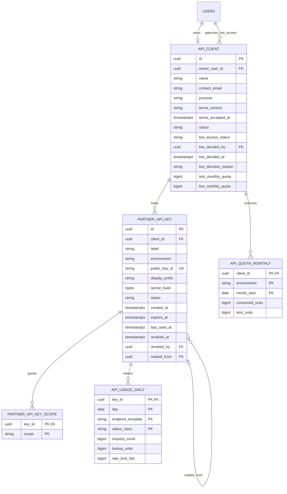

# HerbImmortal partner API: repository review and proposed design

Status: design approved on 2026-11-08. The schema/entity sub-step is implemented;
see [implementation progress](PARTNER_API_PROGRESS.md). Later sections describe
the intended result of subsequent sub-steps, not features already delivered.

## 1. What the completed addition would do

A developer would register, describe their organization and intended use,
accept the applicable terms, and receive sandbox access. They could create a
test key, integrate against synthetic practitioners, and request live access.
An administrator would review that request. After approval, the developer could
create scoped live keys and use their server to check individual Immortal IDs
or a bounded batch. Usage, rate limits, quotas, rotation, suspension, and
revocation would make that access manageable.

The existing practitioner claim, council import, identity review, Immortal ID
issuance, and public verification workflows would remain in place. The addition
would not provide clinical assessments or automated biometric verification.

## 2. Where the repository differs from the PDF's assumptions

| Finding in the current code | Consequence for this design |
| --- | --- |
| Account keys already exist: `ApiKeyController`, `ApiKeyService`, `api_keys`, and the account-page key panel. They are owned by a user and inherit that user's role. | A partner product must not be built by simply exposing these keys to developers. Retain existing personal keys and introduce separate partner credentials. |
| Existing keys are `hi_live_` plus a random body, without a public key ID or dot separator. Both `X-API-Key` and bearer authentication are accepted. | New partner keys use the dotted format below and bearer authentication only. Keep legacy credential behavior for existing account integrations, while explicitly rejecting the new partner format outside partner routes. |
| `/developers` generates mock keys in React memory with `Math.random()`. It does not call the real key-management API. | Remove its simulated credential controls when the real portal is implemented. Public documentation can remain accessible without login. |
| Roles are PRACTITIONER, REVIEWER, and ADMIN, with a PostgreSQL CHECK constraint as well as a Java enum. | Adding DEVELOPER requires a new migration plus backend and frontend role handling. Do not edit an applied migration. |
| Current IDs look like `HI-26INA-K3M7Q` and have no check character. Legacy IDs have a Luhn mod 32 check character and remain supported. | Validate current syntax and legacy checksums. Do not invent a checksum for existing current-format IDs or change issuance. |
| `publicVerify()` selects the most recent APPROVED case among historical cases. It does not establish that the latest case is approved or that the current registry row remains active. | Do not reuse this method as proof of current partner verification. Define a separate conservative partner read policy and flag the existing behavior for a separate decision. |
| Public responses currently label the source batch `live-registry`; registry rows have actual `source_batch` and `synced_at` fields. | Return real provenance where available. Never describe an import timestamp as the council's publication date. |
| No reliable council publication-date field was found in the inspected import schema. | A partner `sourceDate` must be nullable until explicitly supplied and validated source metadata exists. This is a requirement gap, not a date to guess. |
| The identity provider is manual; approved cases do not prove automated face matching or automated liveness. | Document exactly what verification means. No response or quickstart may imply automated biometric checks. |
| Verification states are string values, and `VerificationCase.setStatus()` exists. There is no centralized enum transition map to reuse. | The partner lifecycle will introduce explicit enums and transition maps rather than claim to copy an existing implementation. |
| The local profile logs Hibernate bound values at TRACE. | Secrets must never become entity fields, query parameters, exception messages, or log arguments. Hashes and safe metadata can be persisted; test log capture explicitly. |

Relevant source locations are listed at the end of this document.

## 3. Proposed data model

Names are intentionally distinct from the existing `api_keys` table and classes.



Use foreign keys, UTC timestamps, unique public key IDs, and CHECK constraints
for allowed states. One client per developer owner is the initial policy.
Scopes are constrained values, not arbitrary strings supplied by the caller.

Use the existing append-only `audit_events` table for lifecycle actions, with
safe subject IDs, actor IDs, transition names, and reason codes. Do not store
credential request bodies, generated secrets, or copied authorization headers.
The state mutation and its audit event commit in the same transaction.

Client transitions: PENDING -> ACTIVE after completed onboarding;
ACTIVE -> SUSPENDED; SUSPENDED -> ACTIVE by an administrator.
PENDING clients cannot use keys. An ACTIVE client with unapproved live access
can use TEST keys. This separates client onboarding from live approval.

Live access: NOT_REQUESTED -> PENDING -> APPROVED or REJECTED. A rejected
client can submit a new request; history remains in audit events. LIVE key
creation and use both require APPROVED live access and an ACTIVE client.

Key transitions: ACTIVE -> REVOKED or EXPIRED; both are terminal. Time-based
expiry is enforced during authentication even if a cleanup job has not updated
the stored status. Rotation creates a replacement; it does not reactivate a key.

## 4. Key generation, lookup, rotation, and revocation

Formats:

```text
hi_test_<publicKeyId>.<secret>
hi_live_<publicKeyId>.<secret>
```

Generate 16 random bytes for the public key ID and 32 independent random bytes
for the secret using Java `SecureRandom`. Encode both as unpadded Base64URL.
The secret has 256 bits of entropy. `Random` and browser `Math.random()` are not
credential generators. A recognizable prefix can support secret-scanning
rules; automatic detection by a hosting provider is not guaranteed.

Store SHA-256 of the complete canonical credential, the public key ID, and safe
metadata. SHA-256 is appropriate for a uniformly random 256-bit secret. Password
hashing remains BCrypt because human passwords have much lower entropy.

On authentication, parse a bounded-length bearer credential, look up its indexed
public key ID, and use `MessageDigest.isEqual()` to compare fixed-size hashes.
Include the environment prefix in the digest and compare it with the row's
environment so a prefix cannot be switched. A missing ID uses a dummy hash
comparison and the same external 401 error as every other credential failure.
This reduces comparison timing leakage; it does not claim that an entire
database-backed request has identical timing.

Return plaintext only in the create/rotate response, with `Cache-Control:
no-store`. Do not put it in localStorage, browser query caches, analytics,
toasts, URLs, persisted form state, or subsequent list responses. Hold it only
in the one-time modal; discard it when acknowledged or closed. A lost key must
be replaced. Prevent response-body and header capture by application logging.

Initial rotation overlap: 24 hours, configurable. The replacement is immediately
usable; the old key's expiry becomes the earlier of its current expiry and the
overlap deadline. Revocation always overrides overlap. Lock the old row to
prevent accidental concurrent duplicate rotations. Reject an attempt to rotate
an expired or revoked key. Initial default expiry is 365 days; explicit no-expiry
support is a configurable policy, not an implicit omission.

**Revocation proposal: no positive authentication cache in version 1.** Read
key, owner eligibility, live approval, and client status from the primary
database on each request. Once revocation or suspension commits, an
authentication check beginning afterwards rejects it on every app instance.
There is no TTL propagation delay. Requests already authenticated may finish;
this is not cancellation of in-flight work. Use the primary, not a lagging read
replica. This is a proposed guarantee, not a measured result yet.

Throttle `last_used_at` updates to at most once per key per five minutes, using
bounded asynchronous updates. Failure to record this approximate timestamp does
not grant or revoke access. Avoid making every lookup contend on the key row.

## 5. Authentication boundaries

1. An ordered partner chain matches `/api/v1/partner/**` first. It installs only
   partner bearer authentication and authorizes a distinct `PartnerPrincipal`.
2. A developer-management chain accepts existing JWT sessions and requires the
   DEVELOPER role plus client ownership. Administrator management requires an
   existing ADMIN JWT session.
3. The remaining chain retains existing practitioner, reviewer, and public
   behavior. It explicitly refuses the new dotted partner credential format.

Spring uses the first matching `SecurityFilterChain`, not the combined rules of
all chains. This is similar to mounting a dedicated Express router with its own
authentication middleware before the general router. Prevent security filters
from also being registered as global servlet filters, or this separation can
be bypassed unintentionally.

The legacy resolver must never treat a dotted partner credential as an account
key. Tests cover both `Authorization` and `X-API-Key` attempts on user/admin
routes. A JWT, old personal key, query parameter, cookie, or X-API-Key header
cannot authenticate a partner request. Public endpoints remain publicly usable;
they must never acquire partner privileges from an attached credential.

Reuse existing login and refresh behavior. Add developer-specific registration
that assigns DEVELOPER on the server; do not let general signup accept arbitrary
roles. Existing practitioner accounts are not silently converted into developers.

## 6. Partner lookup policy and response contract

Only the partner lookup layer produces the dedicated partner DTO. It does not
serialize JPA entities, public response maps, admin maps, or verification cases.

Proposed conservative live policy: a practitioner must have a latest case in
APPROVED state, a uniquely matched current registry record marked present, an
ACTIVE registration, and no expired known validity date. Otherwise return the
same NOT_VERIFIED envelope used for a missing ID. This policy is new partner
read behavior and needs agreement because the existing public method selects
historical approvals. Matching, approval, and issuance logic remain unchanged.

Basic response shape, with illustrative synthetic values:

```json
{
  "immortalId": "HI-26INA-K3M7Q",
  "status": "VERIFIED",
  "verifiedAsOf": "2026-11-08T04:00:00Z",
  "displayName": "A. Sharma",
  "specialty": null,
  "registrySource": {
    "reference": "opaque-import-reference",
    "sourceDate": null
  }
}
```

| Field | Scope and purpose | Exposure rule |
| --- | --- | --- |
| `immortalId` | Both; associate a result with the submitted ID. | Echo bounded, normalized input; do not disclose a different linked ID. |
| `status` | Both; VERIFIED or NOT_VERIFIED. | Unknown, pending, rejected, expired, and revoked collapse to NOT_VERIFIED. Do not expose the underlying reason. |
| `verifiedAsOf` | Both; timestamp of the relevant approval decision. | Null when not verified. It is not the time of a government registry check. |
| `displayName` | Basic; help recognize the practitioner. | Initial plus surname by default, consistent with current public minimization. Full-name release is a separate decision. Null when not verified. |
| `specialty` | Basic; registry-backed professional context. | Nullable; do not present a self-declared specialty as council-verified. Omit unsupported claim-derived values. |
| `registrySource.reference` | Both; trace the result to its source. | Opaque reference, never filesystem paths, source filenames containing personal data, or raw import diagnostics. |
| `registrySource.sourceDate` | Both; council publication/effective date if known. | Nullable. Never substitute `synced_at`, upload time, or approval time. |
| `council` | Detail; council code and canonical name. | Verified results only. |
| `registrationValidFrom` | Detail; recorded validity start. | Nullable because current data may not contain it. |
| `registrationValidUntil` | Detail; recorded registration expiry. | Nullable when genuinely unpublished; never fabricate a date. |

`verify:detail` includes the basic fields. Start developers with `verify:basic`;
detail requires an administrator-approved client allowance. A key can request
only a subset of its client's allowances. Do not expose registration numbers,
even masked ones, in this first version: the ID already identifies the lookup,
and another credential identifier is unnecessary for the proposed decision.

For a given scope, unknown and unverified IDs have the same HTTP 200 status,
field set, null personal fields, and generic NOT_VERIFIED value. Detail fields
are null in both. They follow the same read path; tests compare the wire shape.
No images, selfie, contact details, case IDs, rule strings, scores, candidate
lists, or internal reasons appear in partner results.

Validate input before practitioner data access. For current IDs validate syntax;
for legacy IDs also validate the check character. The PDF's requirement of
"before any database query" needs qualification: authenticating the key itself
uses the database. The zero-query assertion applies to practitioner lookup
repositories. Do not change the existing ID format to satisfy a nonexistent
current-format checksum.

## 7. Endpoints, errors, and caching

| Endpoint | Authentication | Result |
| --- | --- | --- |
| `GET /api/v1/partner/practitioners/{immortalId}` | Partner key, basic/detail scope | One minimized lookup result. |
| `POST /api/v1/partner/practitioners/batch` | Partner key, basic/detail scope | Up to 50 input IDs; results preserve order and duplicates. |
| `GET /api/v1/partner/me` | Partner key | Safe client/key IDs, environment, scopes, effective limits, quota and metering freshness. |
| `POST /api/v1/developer/clients` | DEVELOPER JWT | Onboarding and terms acceptance. |
| `GET /api/v1/developer/clients/me` | DEVELOPER JWT | Own client and live-access state. |
| `POST, GET /api/v1/developer/keys` | DEVELOPER JWT | Create or list own keys. |
| `POST /api/v1/developer/keys/{id}/rotate` | DEVELOPER JWT | Replacement credential, shown once. |
| `DELETE /api/v1/developer/keys/{id}` | DEVELOPER JWT | Revoke owned credential. |
| `POST /api/v1/developer/live-access/request` | DEVELOPER JWT | Request live approval. |
| `GET /api/v1/developer/usage` | DEVELOPER JWT | Own aggregated usage. |

Admin endpoints live under `/api/v1/admin/developer-clients/**` and require an
ADMIN JWT. Support listing, pending requests, approve/reject with reason,
suspend/reactivate, revoke a key, and usage overview. Ownership is enforced in
developer queries, not accepted from request JSON. Cross-client key access
returns the same not-found response as an unknown key.

Batch body: `{ "immortalIds": ["..."] }`. One malformed ID gets its own
INVALID_ID error; other IDs continue. Missing/unverified IDs get the normal
NOT_VERIFIED result. Empty, oversized, non-string input, or malformed JSON is
a whole-request 400. Authentication, scope, quota, and infrastructure failures
remain whole-request failures. Batch processing does not bypass per-ID metering.

Error envelope: `{ "error": { "code": "INVALID_API_KEY", "message":
"Authentication failed." }, "requestId": "..." }`. Credential failures use
the same 401 regardless of unknown ID, secret mismatch, expiry, suspension,
or missing approval. Missing scope is 403; invalid input 400; burst/quota 429;
temporary infrastructure failure 503. Correlation IDs are generated or strictly
validated by the server and returned in `X-Request-ID`.

Initial cache policy: `Cache-Control: private, max-age=60, must-revalidate` for
single lookups, with authorization-sensitive caching and no shared CDN storage.
Batch, identity/limits, errors, and credential responses use `no-store`. A
partner may retain a result for at most 60 seconds without rechecking. This
can leave a previously verified result visible for that interval after a
change. HTTP headers cannot force a partner to delete an independent copy.

Version at `/api/v1`. Proposed breaking-change policy: a new major version,
at least 90 days' deprecation notice, published migration notes, and an explicit
sunset date. Emergency credential revocation remains immediate.

## 8. Initial rate limits, quotas, and metering

All values below are starting guesses stored in configuration, not established
capacity measurements or product commitments.

| Setting | TEST | LIVE |
| --- | --- | --- |
| Per-key burst capacity | 10 requests | 20 requests |
| Sustained token refill | 30 requests/minute | 60 requests/minute |
| Client monthly lookup quota | 1,000 IDs | 10,000 IDs |
| IDs per batch | 50 | 50 |
| Active keys per client/environment | 5 | 5 |
| Rotation overlap | 24 hours | 24 hours |

Bucket4j controls request rate. Each admitted single lookup costs one monthly
lookup unit; a batch costs its number of input IDs, including duplicates and
malformed IDs. `/partner/me` consumes rate tokens but no lookup units. Perform
basic body/size validation before allocating batch quota. Use separate TEST
and LIVE quota buckets so sandbox activity cannot exhaust production access.
The quota table's actual key therefore includes client, environment, and month.

Reserve monthly units with one atomic PostgreSQL conditional update per
admitted lookup request, not per ID. A batch is all-or-none at quota admission.
This is synchronous admission accounting, separate from asynchronous analytics.
If quota admission is unavailable, fail closed with 503 and a short database
timeout. It is a deliberate database dependency. Do not pretend an asynchronous
analytics count can strictly enforce a shared quota.

Return `X-RateLimit-Limit`, `X-RateLimit-Remaining`, and
`X-RateLimit-Reset` (UTC Unix seconds). A 429 also returns `Retry-After`
(seconds), with a distinct RATE_LIMIT_EXCEEDED or MONTHLY_QUOTA_EXCEEDED code.
Quota headers are separate from request-rate headers. Never debit quota for a
request rejected by the burst limiter.

Aggregate analytics in a bounded in-memory queue, flush deltas periodically
with PostgreSQL upserts, and label dashboard freshness. Include request count,
lookup units, failures, and rate-limit hits. A full queue or failed flush emits
an operational metric; it must not block lookups. Analytics may lose unflushed
deltas on process failure and must not be presented as an exact billing ledger.
The synchronous quota counter remains the enforcement authority.

Log only request ID, safe key/client IDs, endpoint template, HTTP status, and
latency. Do not log a path containing an Immortal ID, request body, practitioner
name, credential, or authorization header. An invalid key is logged without an
untrusted claimed key ID. Access logs and tracing must follow the same policy.

The initial in-memory Bucket4j limiter is suitable for one instance. With N
instances it can allow approximately N times the configured per-key rate.
Production scaling requires a shared atomic limiter, such as a compatible
Redis-backed Bucket4j integration, before adding instances. Database-backed
credential revocation and monthly admission remain shared across instances.

## 9. Sandbox separation

Provide separate `SandboxPractitionerLookup` and `LivePractitionerLookup`
implementations. The sandbox component depends only on immutable synthetic
fixtures and has no practitioner repository, JDBC, document service, or live
lookup dependency. An architecture test enforces that boundary. After
authentication, environment selects the implementation; there is no fallback
from sandbox to live lookup on a miss.

Use unmistakable IDs such as `HI_TEST_VERIFIED_001`, `HI_TEST_EXPIRED_001`,
`HI_TEST_REVOKED_001`, `HI_TEST_NOT_FOUND_001`, `HI_TEST_NAME_EDGE_001`, and
`HI_TEST_DIACRITICS_001`. They are accepted only by the TEST validator.
LIVE rejects them without a practitioner query. Expired and revoked sandbox
fixtures both produce NOT_VERIFIED, matching the live non-enumeration policy.
The name edge fixture exercises display formatting; it does not expose a match
score or internal mismatch explanation.

Document deterministic TEST-only error fixtures and a controlled way to exhaust
the TEST bucket. No simulation header can be honored by a LIVE key. Test against
a database seeded with realistic rows and prove the sandbox performs no live
practitioner query, even for a production-shaped ID.

## 10. Portal proposal

Reuse the site's paper/ink tokens and UI primitives. Add DEVELOPER guards for
`/developer/onboarding`, `/developer/keys`, `/developer/usage`,
`/developer/docs`, and `/developer/live-access`. Extend the admin console for
client approvals and usage. Public `/developers` remains a truthful overview.

Token mapping: surface -> existing surface; text -> content/content-muted;
border -> border; focus -> focus; active -> verified; pending -> review;
revoked/error -> error. TEST and LIVE always have text badges plus distinct
semantic token styles. No status is conveyed by color alone. Add any needed
semantic aliases once in `tokens.css`, never raw colors inside components.

```text
+------------------------------------------------------------------+
| Developer / Keys                     [TEST environment v]         |
| Organization: Example Clinic         Live access: Pending         |
|                                                                  |
| API keys                                      [Create test key]  |
| Label           Environment  Prefix       Used       Status       |
| Booking server  TEST         hi_test_ab..  5 min ago  Active       |
|                                             [Rotate] [Revoke]    |
|                                                                  |
| Usage: 240 / 1,000 lookup units this month       [View usage]     |
+------------------------------------------------------------------+

+------------------------------------------------------------------+
| Test key created                                                 |
| Copy it now. It cannot be retrieved after this window closes.     |
| [hi_test_<id>.<secret>                                ] [Copy]    |
|                                                                  |
| [ ] I have saved this key securely                                |
| Example request: [curl] [Node] [Python]                            |
|                                                   [Done]         |
+------------------------------------------------------------------+
```

The one-time creation modal may prefill the freshly created TEST key in its
examples. Static docs and later visits use placeholders, not a stored secret.
Revoke confirmation names the label and environment. Generate partner OpenAPI
documentation from the app, excluding administrative schemas and examples with
real credentials. The exact springdoc and Bucket4j dependencies must be checked
against the project's Spring Boot version during implementation.

## 11. Acceptance checks for later implementation

- First write cross-client isolation tests for list, rotate, and revoke.
- Capture DB, logs, audit, errors, and wire responses: plaintext exists only in
  the successful one-time create/rotate response.
- Reject JWTs and legacy personal keys on partner routes; reject partner keys
  on authenticated user/admin/developer routes through both supported legacy
  header forms. Existing JWT regression tests must still pass.
- Reject expired/revoked keys, PENDING/SUSPENDED clients, and unapproved LIVE
  access with identical credential-failure responses.
- Measure revocation visibility after transaction commit on two app instances;
  report existing in-flight requests separately.
- Test sandbox boundaries with realistic database rows and repository spies.
- Test scope projection and forbidden fields against the actual JSON response,
  including negative results, batch, and errors.
- Prove malformed current IDs and bad legacy checksums cause zero practitioner
  queries; authentication queries are explicitly excluded from that assertion.
- Exercise burst rejection headers, refill, client-shared quotas, concurrent
  admission at the boundary, month rollover, and distinct TEST/LIVE budgets.
- Exercise mixed batches, duplicate IDs, all-or-none quota admission, and
  unavailable analytics without slowing or blocking verification.
- Demonstrate a developer can complete sandbox onboarding with the quickstart
  alone in under five minutes. Record actual results; do not infer them from
  source inspection.

## 12. Decisions needing your answer before implementation

1. Approve the separate partner credential product while retaining existing
   personal API keys, or deliberately migrate personal integrations too?
   Recommendation: retain them and isolate partner credentials.
2. Approve initial plus surname and no registration number in partner results?
   Full-name access would require an explicit product decision.
3. Approve nullable council source dates until real publication-date metadata
   is available, or make that metadata a prerequisite for live onboarding?
4. Approve the conservative latest-case/current-registry partner read policy?
   Also decide separately whether the existing public lookup should change.
5. What actual developer terms/version and live-access review criteria should
   onboarding use? A production flow cannot record acceptance of invented terms.
6. Must an existing practitioner be able to become a developer under the same
   account? The current schema has one role per user; the initial design uses
   separate developer accounts rather than silently removing practitioner access.

Directory search/listing is a separate gate. Do not implement it in this phase.
If requested later, decide practitioner disclosure permission and terms first,
then consider admin-granted `directory:read`, required filters, small cursor
pages, and caps on distinct returned practitioners.

## 13. Risks and honest limits

A leaked live key could retrieve the minimized permitted result for guessed or
known IDs within its scopes, burst limits, and remaining client quota. It could
consume that quota. It could not manage keys, view images, access cases, import
registers, or act as a logged-in administrator. Current-format ID suffixes have
a limited search space, so rate limits and quota controls do not eliminate
enumeration risk.

There is no existing partner alerting pipeline to promise a detection time.
Usage and request metrics would make investigation possible; an operational
alert destination, thresholds, and response owner must be configured before
claiming automatic detection. A quiet leaked key may remain unnoticed until
someone reviews it or it expires.

Running a second instance breaks the accuracy of in-memory burst limits and
splits unflushed analytics buffers. Database authentication and quota admission
stay shared. Use a distributed rate limiter before scaling.

`VERIFIED` means the stated approval and imported-registry conditions were met.
It does not mean a live government check, automated biometric proof, or proof
of clinical ability. Source dates may be unknown. The 60-second partner cache
policy is an additional freshness limit, not a guarantee that imported council
data itself is recent.

Future revocation webhooks would attach to a committed verification-status
event, ideally through a transactional outbox. Building delivery, retries,
signatures, subscriptions, or a new practitioner revocation workflow is outside
this phase.

All rate numbers, TTLs, quotas, overlap, scope grants, minimized name policy,
and deprecation period above are proposals. No runtime guarantees or test
results are claimed before implementation and execution.

## Source locations reviewed

- `backend/src/main/java/com/herbimmortal/verification/controller/ApiKeyController.java`
- `backend/src/main/java/com/herbimmortal/verification/service/ApiKeyService.java`
- `backend/src/main/java/com/herbimmortal/verification/security/ApiKeyAuthenticationFilter.java`
- `backend/src/main/java/com/herbimmortal/verification/config/SecurityConfig.java`
- `backend/src/main/java/com/herbimmortal/verification/service/VerificationService.java`
- `backend/src/main/java/com/herbimmortal/verification/util/ImmortalId.java`
- `backend/src/main/java/com/herbimmortal/verification/domain/Role.java`
- `backend/src/main/java/com/herbimmortal/verification/domain/VerificationCase.java`
- `backend/src/main/java/com/herbimmortal/verification/identity/ManualIdentityProvider.java`
- `backend/src/main/resources/db/migration/V2__registry_records.sql`
- `backend/src/main/resources/db/migration/V3__registry_import.sql`
- `backend/src/main/resources/db/migration/V8__verification.sql`
- `backend/src/main/resources/db/migration/V10__accounts.sql`
- `frontend/src/features/auth/components/AccountPage.tsx`
- `frontend/src/features/developer/components/DeveloperPage.tsx`
- `frontend/src/styles/tokens.css`
