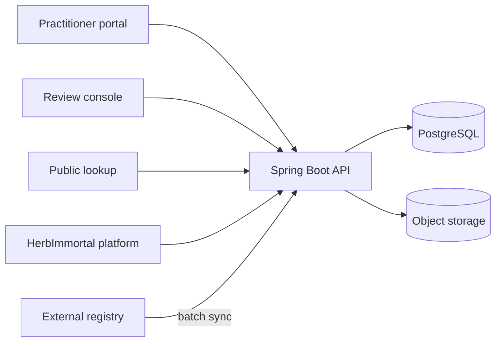
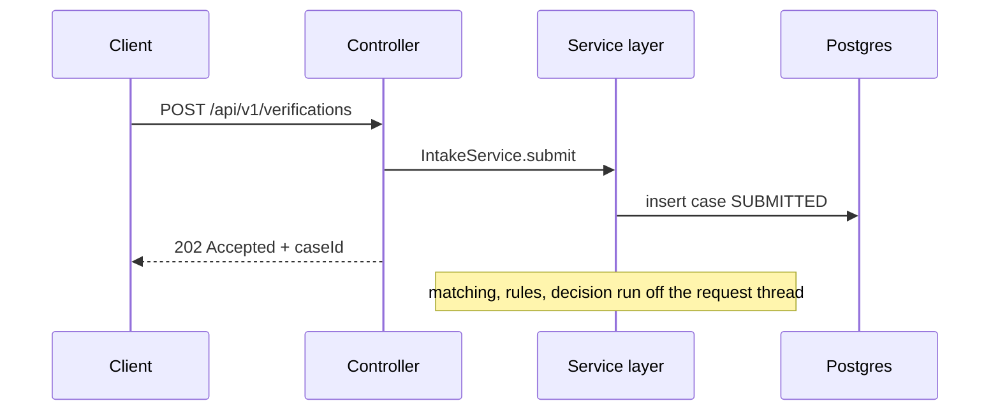

# Architecture

Status: placeholder. Filled in as each phase lands.
The authoritative design decisions live in `/CLAUDE.md` until this file catches up.

## System context

<!-- TODO: replace with the real diagram once phase 5 defines the async boundary. -->

## Request path

<!-- TODO: expand once the async executor is wired in phase 9. -->

## Layering rules

- Controllers do HTTP only. No business logic, no repository calls.
- Services own all verification logic, so the HTTP path, the scheduled job, and
  any bulk import share one implementation.
- Rules never touch the database. They receive a `VerificationContext` and
  return a `RuleResult`, which is what makes them unit testable without Spring.
- Only Flyway changes the schema. Hibernate `ddl-auto` is `none`, permanently.

## Data model

<!-- TODO: entity relationship diagram once the phase 2 to 4 migrations exist. -->
