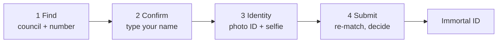
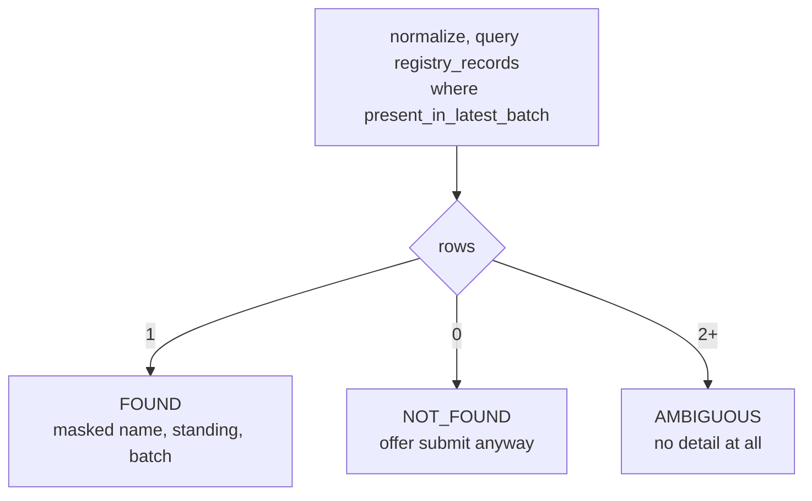
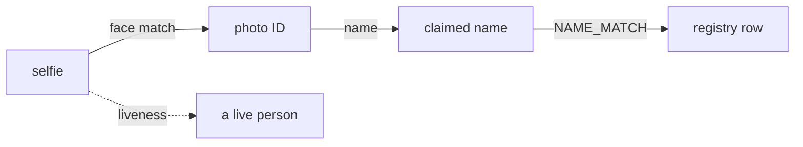
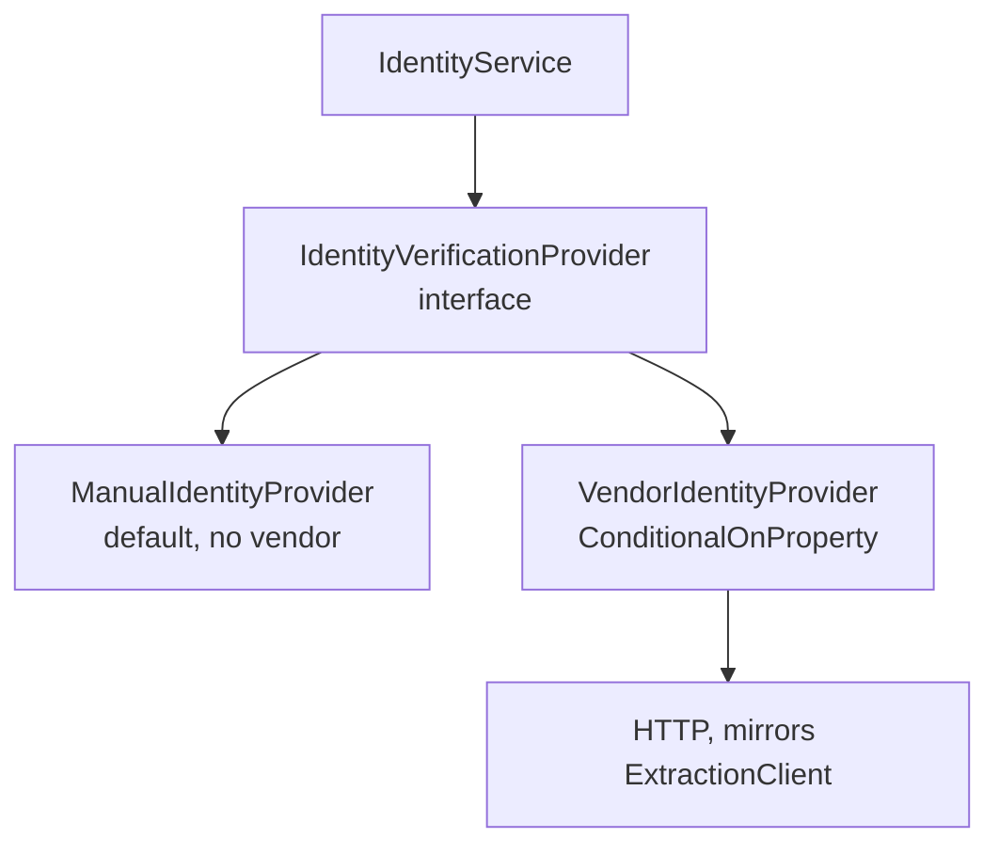
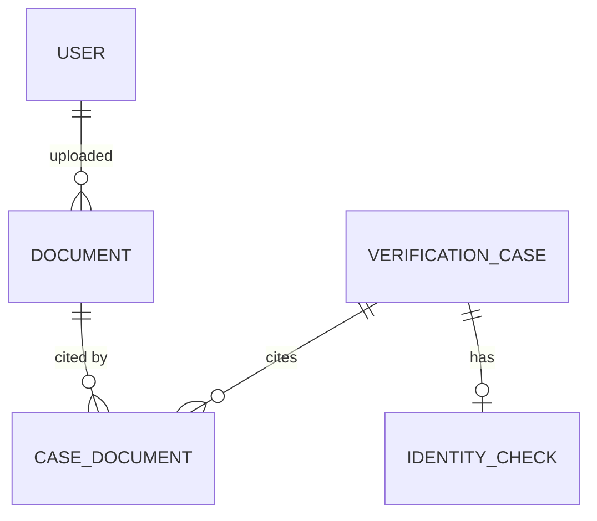
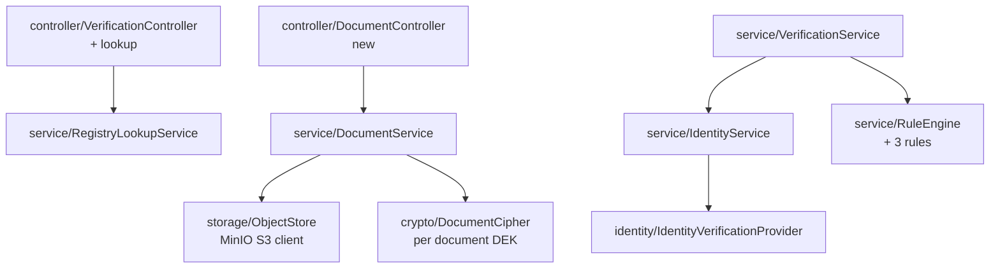

# Phase 9: lookup first claim flow with identity verification

Design document. Not yet agreed, no code written. Supersedes the single form
claim in `SubmitCasePage.tsx`.

Decisions taken before this document:

- **Lookup reveals a masked name.** Not the full registry row.
- **Persona verification is photo ID plus a liveness selfie.** Not certificate
  OCR, not an attestation tick.

---

## 1. What changes

Today a claim is one blind form post. You type six fields, hit submit, and find
out afterwards whether any of it matched. The registration number is the only
field that actually keys the match, and you get no signal about it until the
case is already decided.

The new shape asks for the key first, tells you what it found, and only then
collects the rest.



Nothing about the decision engine changes. `RuleEngine.decide` is untouched,
which is the point of the Strategy shape in CLAUDE.md section 6.1: three new
rules arrive as three new results in the list, and the aggregation that reads
them does not know they exist.

---

## 2. Step 1, the lookup

### 2.1 Endpoint

```
POST /api/v1/verifications/lookup      signed in, rate limited, audited
```

Request:

```json
{ "council": "MH", "registrationNumber": "MH-12345" }
```

Response, identical shape for all three outcomes:

```json
{
  "outcome": "FOUND",
  "councilName": "Maharashtra Council of Indian Medicine",
  "maskedName": "A•••• S••••",
  "standing": "ACTIVE",
  "asOfBatch": "council-2026-07-14"
}
```

`NOT_FOUND` and `AMBIGUOUS` return every field as an empty string. That is the
same rule as section 7.2 of CLAUDE.md: a field that appears only on the found
branch leaks existence through the response *shape*, which is the version of
that bug that survives a review of the values.

The `outcome` code does differ between the three, unlike the public verify
endpoint where unknown and unverified are byte for byte identical. It has to:
the UI offers a different next action for each. What makes that acceptable here
and not there is everything in 2.3 below. This endpoint costs a login and a
budget to query; the public one costs nothing.

### 2.2 POST, not GET

A registration number in a query string ends up in the browser history, the
access log, the referrer header of any outbound link on the page, and any proxy
in between. `POST` keeps it in the body. It is not RESTful and that is fine:
the resource being created is an audit event.

### 2.3 Why this is not a registry scraper

Four controls, and the design needs all four:

| Control | What it stops |
|---|---|
| Signed in | Anonymous enumeration. A harvester needs an account we can lock |
| Rate limit, per user, 20/hour | Bulk walking of the number space |
| Audited as `REGISTRY_LOOKUP` | Makes a harvester visible after the fact |
| Masked name | Caps the value of a successful lookup |

The masking is the load bearing one. The other three raise the cost of a
lookup; masking lowers the payoff. A harvester who gets past all of the first
three walks away with `A•••• S••••` per row, which is not a register.

Mask format: **first character of each name part, then a fixed four bullets**,
regardless of the real length. Fixed width on purpose. Bullets that track the
real length leak it, and name length plus council plus initials narrows a real
person more than it looks like it does.

Rate limiting reuses the D5(a) answer, Bucket4j in memory, at one app instance.
The moment there are two instances the limit multiplies by instance count and
this moves to Redis with the public endpoint.

### 2.4 The three outcomes



`AMBIGUOUS` reveals nothing, not even a count. Showing two masked names side by
side to a claimant would let them pick the one they wanted to be. The claimant
is told a person will look at it, and `SINGLE_CANDIDATE` sends the case to
MANUAL_REVIEW at submit exactly as it does today.

`NOT_FOUND` still offers "submit anyway". Per CLAUDE.md section 4.1(c), zero
candidates means NO_MATCH means MANUAL_REVIEW, always. Someone genuinely
registered whose row has not been imported yet must be able to get in front of
a human.

### 2.5 No case is created here

The lookup writes an audit event and nothing else.

Why not create a draft case: `uq_practitioner_open_case` allows one non terminal
case per practitioner. A draft created at lookup and abandoned would block that
person from ever claiming again, and unblocking them would mean either a
sweeper job deleting cases (against non negotiable 1) or widening the index
until it stops being the guard it is.

Wizard state lives in the browser until submit. Uploaded documents live server
side from the moment they are confirmed, which the schema already anticipates:
`case_documents` is a join table precisely because a document exists
independently of any case.

### 2.6 The preview is advisory, always

`POST /api/v1/verifications` re-runs the match from scratch. It does not carry
the matched record id forward from the lookup.

A batch can be promoted between the two calls. `registry_snapshot` has to record
what was true at *decision* time, not at lookup time, or non negotiable 2 is a
lie. The lookup is a UI affordance, not a step in the decision.

---

## 3. Step 2, and why the name is typed

The masked name is shown. The full name is typed by the person.

This is not friction for its own sake. If the lookup pre-filled `ANAND SHARMA`
and the person clicked confirm, `NAME_MATCH` would score 1.00 against a string
we handed them. It is a `required = true` rule in the catalog and it would be
measuring nothing.

Typing `A•••• S••••` back as `ANAND SHARMA` is a real piece of evidence: they
produced the unmasked string from knowledge, not from the screen. The rule keeps
its meaning and the person still gets the moment where the system says "yes,
that registration is on the register".

Medical system and specialty are also collected here rather than at step 1,
because neither narrows the lookup and the medical system character is written
permanently into the Immortal ID.

---

## 4. Step 3, identity verification

### 4.1 What this can and cannot prove

Stated plainly because it changes what the feature is worth:



The chain is: a live person, holding this government ID, whose name matches the
name on the register.

**The registry holds no photograph.** So the face is never bound to the
registration, only to the ID document. The link from the ID to the registration
is the name, and nothing else. Two people with the same name in the same council
is the residual attack and this design does not close it. Only a register that
publishes photographs, or a council API that verifies against one, would.

Worth knowing before the vendor invoice arrives. Liveness raises the cost of
impersonation a great deal; it does not reduce it to zero.

### 4.2 The provider port

CLAUDE.md section 2 fixes the stack and no KYC vendor is in it. So the vendor
sits behind an interface, and ships with a working local implementation.



`ManualIdentityProvider` is the default and it is not a stub. It stores both
images and returns `PENDING_HUMAN`, which makes `LIVENESS_PASSED` and
`FACE_MATCH` return REVIEW, which routes every claim to MANUAL_REVIEW, where a
reviewer sees the photo ID and the selfie side by side in the console and
decides. **A human is the liveness check until a vendor is wired.**

That is the whole benefit of the port: the flow works end to end on your machine
this week with no contract signed, and turning the vendor on is a config change
that stops routing everything to a person.

`@ConditionalOnProperty` is the Spring annotation that creates a bean only when
a config key is set. The FastAPI equivalent is choosing an implementation inside
a dependency provider based on a settings value.

### 4.3 Storage, and the part that needs care

A selfie and a government ID are the most sensitive data this system will ever
hold. Non negotiable 5 requires encryption at rest, role restricted access, and
an audit event on every read.

New in Docker Compose: **MinIO**, which CLAUDE.md section 2 already names as the
local S3. It is not in `docker-compose.yml` yet.

**Per document encryption key.** Each document row holds its own data key,
itself encrypted with a master key from config. The object in MinIO is
encrypted with the data key.

Why not just server side encryption at the bucket: destroying one person's
documents then means deleting objects, and non negotiable 1 says nothing is hard
deleted. Destroying the per document key leaves the row, the audit trail and the
case intact while making the image permanently unreadable. That is crypto
shredding, and it is the mechanism CLAUDE.md section 10 asks for when it flags
the erasure versus append only tension. This is where that tension actually
bites, so this is where it gets solved.

**Retention: destroy the key 90 days after the case goes terminal.** There is no
reason to hold a government ID forever. The verification decision, the rule
results and the registry snapshot are the durable record; the ID scan was
evidence for one decision.

### 4.4 Schema



`documents`: `id`, `owner_user_id`, `kind`, `storage_key`, `content_type`,
`size_bytes`, `sha256`, `status`, `encrypted_dek`, `dek_destroyed_at`,
`uploaded_at`.

`kind` is `PHOTO_ID`, `SELFIE` or `REGISTRATION_CERTIFICATE`. The third is not
used by this phase and is there because the column is cheaper to add now than
to migrate later.

`identity_checks`: `case_id`, `provider`, `provider_ref`, `outcome`,
`face_match_score`, `liveness_score`, `evidence` jsonb, `checked_at`.

Separate table rather than columns on the case, because a vendor check has its
own retry and its own timestamp, and a case that was decided by a human has no
vendor result at all.

### 4.5 Three new rules

| Code | PASS | REVIEW | FAIL | Required |
|---|---|---|---|---|
| `ID_NAME_MATCH` | ID name vs claim >= 0.90 | 0.75 to 0.90, or no OCR | < 0.75 | yes |
| `FACE_MATCH` | selfie vs ID portrait above threshold | no provider result | below threshold | yes |
| `LIVENESS_PASSED` | provider says live | manual provider, no result | provider says spoof | yes |

All three `required = true`, so a `SKIPPED` is promoted to REVIEW by decision
rule 4. With the manual provider that means everything reaches a person, which
is the honest outcome when no automated check ran.

`RuleEngine.evaluate` gains a parameter for the identity result. Its signature
changes; its `decide` does not.

---

## 5. Package layout



Two new packages, `storage` and `identity`, on the same reasoning CLAUDE.md
section 9 gives for `security` and `job`: they hold behaviour, not wiring, so
they do not belong in `config`.

---

## 6. Build order

Four slices, each independently runnable, per "do not start a phase until the
previous one is confirmed running on my machine".

| Slice | Deliverable | Ships |
|---|---|---|
| **9a** | Lookup endpoint, masking, rate limit, audit, wizard shell. **Done.** V11, `RegistryLookupService`, two step `SubmitCasePage` | The details-pop-out moment. No identity step yet |
| **9b** | MinIO, documents table, encrypted upload, audited reads, crypto shred. **Done.** V13, `DocumentCipher`, `ObjectStore`, `DocumentService` | Upload works, reviewers can read |
| **9c** | Identity port, manual provider, three rules, documents on the review detail. **Done.** `identity/`, `IdentityService` | Full flow, human as the liveness check |
| **9d** | Vendor adapter | Auto approval resumes |

### 6.1 Three things that changed once it was built

**Upload goes through Spring, not a presigned URL.** Section 7 sketched
`/documents/presign` and `/documents/confirm`, which is right for registry
files: large, not secret. It is wrong for a government ID. A presigned PUT
writes the browser's plaintext straight into the bucket, so the per document key
would be protecting bytes that had already been stored unprotected, and non
negotiable 5 would hold on paper only. Encrypting in the request path is the
only ordering under which "encrypted at rest" is true. The cost is a few
megabytes through the app server, which at under 500 verifications a day is not
a cost.

**`ID_NAME_MATCH` was not built.** It was specified as comparing the name
printed on the photo ID against the claim, and nothing available can produce
that name: the extraction sidecar reports `"ocr": "UNAVAILABLE"` and no vendor
is wired, so the rule could only ever return SKIPPED. A rule that can never run
is worse than an absent one, because the review console would display a check
that looks like it means something. It arrives with whatever first reads a
document.

The three that shipped are `IDENTITY_DOCUMENTS` (were both images supplied),
`FACE_MATCH` and `LIVENESS_PASSED`. All three required, so SKIPPED becomes
REVIEW.

**`IDENTITY_DOCUMENTS` returns REVIEW when absent, not FAIL.** Hard failing a
claim with no images would make the scheduled re-verification job impossible:
it re-checks an approved practitioner against a fresh registry batch with nobody
at a keyboard, so it has no new images to offer, and the first run would revoke
everybody. The portal requires both images; the server routes their absence to a
person.

9a is worth having on its own even if the rest slips. 9d is the only slice
blocked on a commercial decision.

---

## 7. Checklist for the end of 9a

- [ ] `POST /verifications/lookup` returns FOUND with a masked name for a
      registration number that is in `registry_records`
- [ ] The same endpoint returns identically shaped empty fields for a number
      that is not
- [ ] The 21st lookup in an hour from one account is refused
- [ ] Every lookup, including refused ones, appears in `audit_events`
- [ ] The wizard carries state across four steps without creating a case
- [ ] Submitting from the wizard produces the same decision the old form did
- [ ] An abandoned wizard leaves no open case behind

## 8. Questions to check the design landed

1. Why does the lookup return an empty `maskedName` rather than omitting the
   field entirely when nothing was found?
2. The wizard could store its state in a `draft_cases` table instead of the
   browser. What breaks if it does?
3. `POST /verifications` re-runs the match instead of trusting the id the
   lookup already found. What goes wrong if it trusts it?
4. `ManualIdentityProvider` returns REVIEW rather than PASS for
   `LIVENESS_PASSED`. Why is REVIEW the right answer and not SKIPPED?
5. Destroying the per document key leaves the `documents` row in place. Which
   non negotiable does that satisfy, and which one would deleting the row break?
